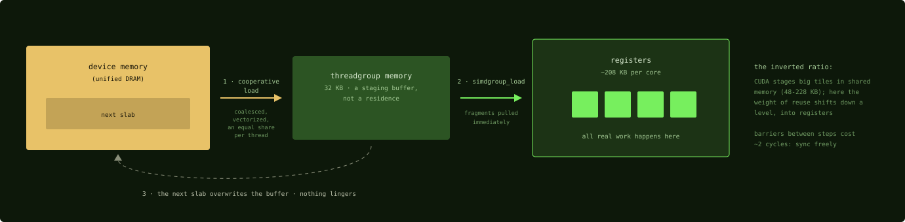

# The core's memories: 208 KB of registers, 32 KB of scratch

## Where we are

You left Chapter 1 with the levels named and one rule in hand: a threadgroup runs
on one GPU core. Now you need to know what that core holds. It has two memories that
a kernel addresses directly, a register file and a scratch memory that Metal calls
threadgroup memory, plus caches that the hardware manages on the kernel's behalf.
Measure them and you can see why the matrix multiply this book follows has the
shape it has. On this chip the output lives in registers, and input tiles pass
through the scratch memory without staying there.

## Three memories, measured

Before you build on the numbers below, know where they come from: none of them
come from Apple. The community measured them, chiefly in
philipturner's metal-benchmarks, on M1- and M2-class chips (Apple GPU families 7
and 8). The glossary and this book use them as the design budget for every M-series
chip. That is an assumption: on M3 and later, a feature Apple calls Dynamic Caching
allocates the per-core memories on demand from one pool, and the sources hold no
measurement of its effect on these limits.

| Memory | Per Apple GPU core | The NVIDIA number you know |
|---|---|---|
| Register file | about 208 KB | about 256 KB per SM |
| Scratch (threadgroup memory here, shared memory there) | about 60 KB physical per core; any one threadgroup may use at most 32 KB | up to 228 KB per SM on an H100, configurable |
| Caches | about 8 KB of L1 data and about 12 KB of instruction cache per core; behind the cores, a small L2 | an A100 has a 40 MB L2 behind its SMs |

Compare the rows at the same scope. Per core, the two register files are nearly the
same size. Per core, the scratch memory is about 60 KB against up to 228 KB, and
per threadgroup it is capped at 32 KB with no carveout setting to raise it. Several
resident threadgroups share the core's 60 KB (seven of the 8 KB kernel below;
two at the 32 KB cap would not fit), so the per-threadgroup cap and the per-core
capacity are different limits, and Chapter 4 uses both. The cache row says
the caches will not rescue you if the kernel does not plan its reuse. 8 KB of L1 is
small, and there is no 40 MB L2 behind it.

## What the ratio does to the matrix multiply

On NVIDIA, you can stage a large input tile of a matrix multiply in shared memory,
because there is a lot of it. What do you do when there is not? Here the scratch memory is the scarcer resource, so
the input slab staged per iteration is thin, and the data that must stay resident
for the whole kernel, the output, stays in registers. Count the bytes for the
kernel this book follows. One threadgroup of four simdgroups computes a 64 by 64
patch of the output, and each simdgroup owns a 32 by 32 quarter of it.

A 32 by 32 patch of 32-bit floats is 1,024 values, which is 4 KB. Spread over the
32 threads of the simdgroup, that is 32 floats per thread, 128 bytes of register
payload per thread, held for the whole life of the kernel. Four simdgroups hold
16 KB of accumulators between them, and none of it ever touches the scratch memory.
That figure is the accumulator payload only. Input fragments, addresses, loop
counters and epilogue temporaries also live in registers, and the compiler decides
the total.

The scratch memory holds the current slab of inputs. The kernel consumes the shared
dimension 16 values at a time, so it stages a 64 by 16 tile of A and a 16 by 64
tile of B: 1,024 floats each, 4 KB each, 8 KB in all, out of the 32 KB allowed.

So the scratch memory carries 8 KB of inputs that are replaced every iteration, and
the registers carry 16 KB of results that are written to device memory exactly once.
A kernel written for this chip has roughly these proportions.

## The house pattern

How do those inputs get from device memory into registers? The matrix
multiply moves them the same way on every iteration, and MLX's attention kernel in
Part 6 moves its key and value tiles the same way.

1. The threadgroup cooperatively copies a slab from device memory into threadgroup
   memory. The copy is coalesced and vectorized, and every thread carries an
   equal share.
2. A threadgroup barrier makes every thread wait until the whole slab has arrived.
3. Each simdgroup pulls fragments of the slab into registers with
   `simdgroup_load` and multiplies there. The slab must survive every fragment read
   of the step, not only the first one.
4. A second barrier makes every simdgroup wait until all of them have finished
   reading, and only then does the next slab overwrite the buffer.

*How input tiles pass through. The diagram labels the buffer with its 32 KB cap;
the kernel this book follows uses 8 KB of it. The dashed loop is the next slab
overwriting the buffer after the second barrier.*

Not everything in threadgroup memory is a passing slab. A small tile that every
iteration reads, such as the query tile in the attention kernel of Chapter 21,
stays resident for the whole loop. The rule applies to the big inputs, which are
staged, consumed and replaced on every iteration.

Two behaviors of the scratch memory keep kernels in this shape. Scattered access to
it is comparatively expensive, and the fast pattern is straight-line, contiguous,
vectorized access. The sources give no bank mapping, so treat this as a rule of
thumb and measure it yourself. The barrier instruction itself is nearly free on this hardware,
so the two barriers per iteration cost almost nothing beyond the time spent waiting
for the slowest simdgroup; Chapter 7 gives the measured instruction cost. Kernels
therefore stage with simple coalesced copies, put a barrier at every hazard, and
avoid scattered access.

When your working set will not fit in 32 KB, no setting gives a threadgroup more.
You have two responses. Shrink the slab, consuming the shared dimension in smaller
steps, or move values into registers, which works when each
value is read by only one simdgroup, because a register value can be shared
within a simdgroup through shuffles (Chapter 1) but never across simdgroups.

## Spilling, the first cliff

With so much of the kernel's state in the register file, the question is what
happens when it runs out. That failure mode is the first one you need to recognize.
The compiler decides each thread's register budget when it
builds the pipeline, and the budget depends on how many threads it must plan for:
without the `max_total_threads_per_threadgroup` attribute from Chapter 1, it plans
for the largest threadgroup the hardware allows and gives each thread less. When a
kernel's live values exceed the budget, the compiler spills some of them to memory,
and every update of a spilled accumulator pays a load and a store around the
arithmetic.

Later chapters refer back to one measurement from the kernel this book follows.
Its author tried a larger patch per simdgroup, 64 by 64 instead of 32 by
32, which raises the accumulator count from 16 fragments of 8 by 8 to 64: 128
accumulator registers per thread before any fragment, address or counter. The
kernel ran 10 times slower, not 10 percent slower, because accumulators spilled,
and it did so with the threadgroup-size attribute already declared in the file.
The payload arithmetic alone does not predict the cliff: 64 KB of accumulators
across four simdgroups is well under the 208 KB file, but the limit is each
thread's share of the file for the threads the compiler plans to keep resident,
and only the compiler's output shows where that share runs out (Chapter 26).
The number is a measurement; Chapter 12 reads the loop it came from.

When an Apple kernel is unexpectedly slow, suspect spills first, the way you would suspect uncoalesced loads first on NVIDIA. Confirming
them takes the compiler's output, and Chapter 26 shows how to read it. Two levers
reduce register pressure, and both appear in the kernels this book reads. The
first is the attribute above, which lets the allocator commit to a per-thread
budget for the real threadgroup size. The second is 16-bit values, which halve
the register payload of every value stored in 16 bits; Chapter 4 turns that into a
rule.

Registers also interact with how many threadgroups a core can hold at once, in the
familiar CUDA way: when registers are the limiting resource, more registers per
thread means fewer resident simdgroups. A larger scratch footprint per threadgroup
can have the same effect when scratch becomes the limit, and that is part of the
cost of double buffering, which allocates two staging buffers so that the next
slab's loads can be issued, by the same threads, before the current slab's math
is done. Chapter 4
sets the balance point, and Chapter 14 measures the trade.

## Check yourself

1. A simdgroup holds a 32 by 32 patch of 16-bit floats instead of 32-bit floats.
   How many bytes of register payload per thread does the patch take, and how does
   that compare with the 32-bit case?
2. A CUDA port stages a 128 by 32 tile of 32-bit A values and a 32 by 128 tile of
   32-bit B values in threadgroup memory. Does it fit the cap, and what are the two
   responses if it did not?
3. A kernel that worked at a 32 by 32 patch per simdgroup runs 10 times slower at
   64 by 64. What is the first thing to suspect, and why does the payload
   arithmetic not predict it?

### Answers

1. 1,024 values at 2 bytes each is 2 KB per simdgroup, 64 bytes per thread, half of
   the 128 bytes the 32-bit patch takes. This is payload, not the compiler's total
   allocation.
2. Each tile is 4,096 floats, 16 KB, so the two together are 32 KB: exactly the
   cap, with nothing left over. The responses are to consume the shared dimension
   in smaller steps so the slab shrinks, or to keep in registers any values that
   only one simdgroup reads.
3. Register spilling: the larger patch needs four times the accumulators per
   simdgroup, 128 accumulator registers per thread. Payload does not predict it
   because the limit is each thread's share of the file for the resident threads
   the compiler planned for, a budget set at pipeline build, not the 208 KB of
   the whole file; and the kernel already declared its threadgroup size, so the
   attribute is not what moved this number.

The next chapter goes below the core, to the one memory pool that every
threadgroup reads from, and to the number that decides most kernel designs here.

Next: [One memory pool and the one law: bandwidth](03-one-memory-pool-one-law.md)
