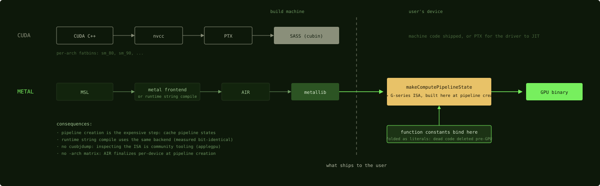

# From source to pipeline state

## Where we are

You come out of Part 1 knowing the chip. Part 2 gives you the least amount of
Metal you need to compile a kernel, launch it, and time it, which is what Part 3
and Part 4 then do. Here you take the first half of that path: what Metal is, what
the kernel language looks like when you read it as CUDA C++, and how source
becomes something the GPU can run. The vocabulary is new; the shape is mostly familiar, with one
difference that every later chapter depends on.

## Metal, the one API

On the CUDA side you reach the GPU through the driver API, the runtime API, and
half of the toolkit. Metal, Apple's single graphics-and-compute API, occupies all
of that ground: it owns devices, queues, memory, and kernel execution. You will recognize the
operations, though Metal groups them under one API.

| CUDA | Metal | Where |
|---|---|---|
| `cudaGetDevice`, a context | `MTLDevice`, one object, usually one per chip | this chapter |
| a stream | `MTLCommandQueue` | Chapter 7 |
| a kernel launch, `<<<...>>>` | a dispatch encoded into a `MTLCommandBuffer` | Chapter 7 |
| `cudaMalloc` | a `MTLBuffer` from the device: private storage mode is GPU-only like `cudaMalloc`, shared mode is one allocation the CPU and GPU both see | this chapter |
| CUDA C++ | the Metal Shading Language, MSL | this chapter |
| nvcc, PTX, cubin, JIT | the metal compiler, AIR, a metallib, pipeline states | this chapter |
| template instantiation per configuration | templates plus function constants | Chapter 8 |
| NVRTC | `makeLibrary(source:)`, run-time compilation of a source string | this chapter |
| cuBLAS, cuDNN | MPS, with caveats | Chapter 9 |
| Nsight Compute | nothing comparable | Chapter 9 |

Three of the differences are in shape, not vocabulary. The first is that
everything is explicit and command-buffer shaped. CUDA lets you pretend that
`kernel<<<grid, block>>>(args)` is a function call. Metal never does: you create a
command buffer, encode one or more dispatches into it with an encoder, commit it,
and optionally wait. You write more host code, but that is where you optimize:
many dispatches in one command buffer share the per-buffer cost. Chapter 7 is about that, and about where batching stops paying.

The second is that compute and graphics are one API. There is no compute edition
of Metal; the `MTLDevice` you encode a matrix multiply on is the one games render
with. If you work on ML, the documentation, the tooling, and half the API
surface (render passes and textures) are about someone else's problems, and the
compute story is comparatively under-documented. That gap is why this book exists.

The third is that there is one device per machine, on Apple Silicon. The API can
enumerate several
devices and expose peer groups, but an Apple Silicon Mac has one GPU: no NVLink,
no second card, no peer access. Scaling inside a box means buying more unified
memory, Chapter 3; scaling across boxes is Chapter 27.

From Python you rarely touch this API directly. MLX wraps it, Part 5, and PyObjC
reaches it when you need raw control. The matrix-multiply harness this book
follows, `metal.py` in m5-gemm, is a compact worked example: compile source, get
the named function, build a pipeline, fill buffers, encode, commit, read GPU
timestamps. A shared-mode `MTLBuffer` exposes its bytes to the CPU through
`contents()`, so a NumPy array can be a view of the same allocation, which is the
unified memory of Chapter 3 seen from the API. This harness allocates and copies
its inputs into fresh shared buffers on every call, outside the GPU timestamps,
and views the output buffer after the command buffer completes.

## The language: CUDA C++ with an accent

How far is the kernel language from the CUDA C++ you already write? MSL is the
C++ dialect that Metal kernels are written in: C++14 with GPU address spaces,
kernel attributes, and a SIMD standard library. If you can read CUDA C++ you can
read it. Here is the signature of the kernel this book follows.

```metal
kernel void __attribute__((max_total_threads_per_threadgroup(SW * SW * 32)))
matmul(
    constant uint  &n,
    constant uint  &k,
    constant uint  &m,
    constant float &alpha,
    constant float &beta,
    const device float *A,
    const device float *B,
    device float       *C,
    ushort3 t_tg_pos       [[thread_position_in_threadgroup]],
    ushort3 tg_pos         [[threadgroup_position_in_grid]],
    ushort3 tg_size        [[threads_per_threadgroup]])
```
Source: [m5-gemm `sync_copy.metal:84-96`](https://github.com/yaroslavvb/m5-gemm/blob/29414bebb522ddacaa009959f2bcdad9f5b3e5cf/sync_copy.metal#L84-L96)

Read it against CUDA.

| CUDA | MSL |
|---|---|
| `__global__ void f(...)` | `kernel void f(...)` |
| a `__device__` function | a plain function, or `METAL_FUNC` in MLX's style |
| pointer arguments | address-spaced pointers: `device` for global memory, `constant` for uniform cached data, `threadgroup`, `thread` |
| `threadIdx`, `blockIdx`, `blockDim` | attribute-tagged parameters: `[[thread_position_in_threadgroup]]`, `[[threadgroup_position_in_grid]]`, `[[threads_per_threadgroup]]`, `[[thread_position_in_grid]]` |
| `__shared__ float s[N];` | `threadgroup float s[N];`, in the kernel, static size |
| `__launch_bounds__(n)` | `__attribute__((max_total_threads_per_threadgroup(n)))`, Chapter 1 |
| `#pragma unroll` | `#pragma clang loop unroll(full)` |
| `-D` compile defines | the same, plus function constants for specialization after compilation, Chapter 8 |

Notice two things in the signature. `SW` is not defined in the kernel; it
arrives as a `-D` define when the source is compiled, so changing it means
recompiling the source. And `constant uint &n` is an argument in the `constant`
address space, which is uniform and cached, not a function constant; the two use
the same keyword and are different things, as Chapter 8 explains.

The indexing vocabulary replaces CUDA's `blockIdx * blockDim + threadIdx` arithmetic when you
want it to: `[[thread_position_in_grid]]` gives the composed index directly, one
component per axis. This kernel instead takes the position inside the
threadgroup, the threadgroup's position in the grid, and the threadgroup size,
and composes two different things: a flat thread index inside the threadgroup
for the cooperative load, and a tile origin from the threadgroup position times
the compile-time tile size, because a tiled matrix multiply maps threads to
tiles, not to output elements. The address
spaces are explicit in the types, so a pointer into threadgroup memory and a
pointer into device memory cannot be confused.

MSL has several features you will use: real C++ templates in device code, which is how
MLX's whole steel library is built, Part 5; `half` and `bfloat` as first-class
types with `vec<T, N>` vectors; the `simdgroup_matrix` types of Chapter 12; and a
`fast::` math namespace that gives you fast math per call, such as the
`fast::exp2` of Chapter 5, in addition to the whole-program fast-math option,
which is on by default.

Coming from CUDA, you will find several things missing: no printf-debugging culture to speak of (it
exists, and it is painful); no cooperative groups beyond the simdgroup and threadgroup barriers of Chapter
1; no dynamic parallelism, though a kernel can write a later dispatch's grid size
for an indirect dispatch to read; no sizing of threadgroup memory from inside
the kernel, since the host sets it with `setThreadgroupMemoryLength` or you declare
it statically; and no inline assembly equivalent to PTX. There used to be one
escape hatch, compiler intrinsics reached through inline-assembly linkage,
`__asm("air.*")`, and Metal 4 closed it; Chapter 14 tells that story.

If you want to write kernels before Part 4, Metal-Puzzles is a set of 14
progressively harder MSL kernels, from a map through threadgroup memory and prefix
sums to a matrix multiply, each checked against a reference from Python.

## From source to a pipeline state

In CUDA, machine code ships with the program, or the driver finishes it from
PTX. Where does Metal make it? Here is the compilation path, stage by stage against CUDA.

| CUDA | Metal | Note |
|---|---|---|
| CUDA C++ | MSL | |
| nvcc | the `metal` frontend, `xcrun metal`, or compilation at run time | |
| PTX | AIR, Apple's intermediate representation, based on LLVM bitcode | portable across GPU generations |
| cubin, SASS | the GPU binary inside a pipeline state | built on the device at pipeline creation; a binary archive can cache that device's build between runs |
| a fatbin, or JIT from PTX | a metallib, loaded as a `MTLLibrary`; get a `MTLFunction` by name; make a `MTLComputePipelineState` from it | the on-device compile is the normal path |
| the `-arch=sm_90` matrix | nothing | AIR is finalized per device when the pipeline is created |



*The dashed line is the ship boundary. CUDA crosses it with machine code, or
with PTX for the driver to finish. Metal crosses it with portable intermediate
code and finishes compiling on the user's
device, which is what lets function constants take part in the final compile.*

The difference every later chapter depends on: creating the pipeline state
turns AIR into instructions for your GPU. The normal path to machine code runs on the device. You can and should compile MSL to a
metallib ahead of time for application startup, but the last step, from AIR to the
instruction set of the GPU in the machine, happens inside the call that makes the
pipeline state. Metal does offer binary archives, but they are a cache of a binary already
built on that machine for that GPU and OS build, not a portable cubin: Draw
Things' MFA uses one and falls back to compiling on a miss, MLX does not use one,
and the applegpu compile tool of Chapter 26 builds one to get at the binary. Two
consequences follow.

First, pipeline creation is the expensive step, and it is a host-side call. Create
each pipeline once and keep it, the way you would keep a cuBLAS handle, keyed by
the function and the values it was specialized with. The GPU timestamps of
Chapter 9 exclude it by construction, since they bracket GPU execution of one
command buffer; creating pipelines before the timed loop keeps it out of any CPU
clock around the launch as well.

Second, the function constants declared in the source take part in that final
compile. That is what Chapter 8 is about: values the final compiler treats as
literals, so that branches on them disappear from the binary instead of being
evaluated at run time.

Compiling a source string at run time is a first-class workflow. `device.makeLibrary(source:)` compiles an MSL string through the same
backend as the offline compiler, and the m5-gemm README measured no performance
difference between the two with `-O3 -ffast-math`. This is why
metal-flash-attention generates its kernels as Swift strings, Chapter 21, MLX
compiles specialized kernels at run time, Chapter 17, and a Python harness
needs no Xcode at all.

Which settings can you change without recompiling the source?
C++ templates are fixed when MSL becomes AIR, and steel uses them for tile shapes
and data types. Preprocessor `-D` defines are fixed at the same stage, and the
matrix multiply this book follows sets its tile sizes with them. Function
constants are fixed when AIR becomes a binary, so one shipped function yields many
pipelines. Sizes and pointers are buffer arguments, read at run time, alongside
the dispatch dimensions.

To inspect what the compiler emitted, you need community tooling. There is no
`cuobjdump`; the reverse-engineered applegpu disassembler is the scriptable
equivalent, MSL in and instructions out, and it is the standard move when a
kernel underperforms and you suspect spills or missed unrolling. Chapter 26 uses
it.

## Review the content

1. A CUDA program ships a fatbin with a cubin for each target architecture. What
   does the Metal equivalent ship, and where is the machine code made?
2. Where does the cost of compiling a kernel land in a Metal program, and what
   does a benchmark harness do so that GPU timestamps never contain it?
3. A CUDA kernel computes its global index as `blockIdx.x * blockDim.x +
   threadIdx.x`. What are the two ways an MSL kernel can get the same information,
   and which does the kernel above use?

### Answers

1. A metallib holding AIR, the portable intermediate representation. On the
   normal path, the machine code is made on the user's device when the pipeline
   state is created. A binary archive can cache that device's build between runs.
2. In the host-side call that creates the pipeline state, before any dispatch.
   The GPU timestamps bracket GPU execution of one command buffer, so they
   exclude it by construction; the harness also creates its pipelines before the
   timed loop, so no CPU clock around the launch contains it either.
3. Either declare a parameter with `[[thread_position_in_grid]]`, which gives the
   composed index, or compose it from `[[threadgroup_position_in_grid]]`,
   `[[threads_per_threadgroup]]` and `[[thread_position_in_threadgroup]]`. The
   kernel above never forms a global thread index: it composes a flat index
   inside the threadgroup from the thread position and the threadgroup size, and
   a tile origin from the threadgroup position times the tile size, because it
   maps threads to tiles rather than to output elements.

The pipeline state is a kernel ready to run, and the next chapter launches it, in
the batching model that is one of the platform's biggest free performance levers.

Next: [Launching, batching, and waiting](07-launching-batching-waiting.md)
