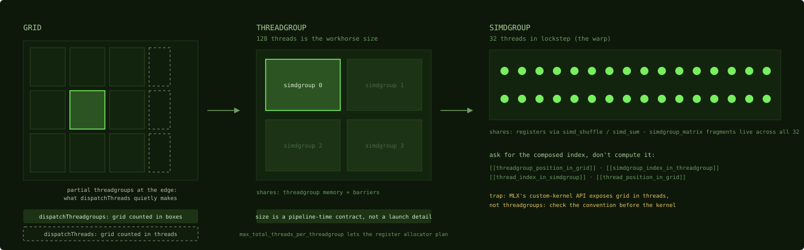
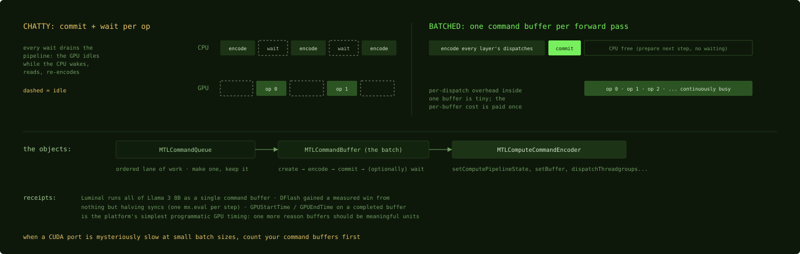

# Launching, batching, and waiting

## Where we are

Chapter 6 ended with a pipeline state: a compiled kernel, ready to run. This
chapter runs it. Three things happen between a pipeline state and a result: you
describe the grid, you put the dispatch into a command buffer and hand it to the
GPU, and at some point you wait. Describing the grid has two traps for CUDA
programmers. Batching is the platform's largest lever that needs no kernel code, and waiting is where the time goes when a port from CUDA is
mysteriously slow.

## The grid, and two traps

A Metal dispatch launches a grid of threadgroups of threads: CUDA's grid, block,
and thread hierarchy under the names of Chapter 1. Both API-level traps come from
Metal being explicit where CUDA is implicit.

**Trap one: two dispatch calls with different units.**
`dispatchThreadgroups(gridSize, threadsPerThreadgroup:)` counts the grid in
threadgroups, exactly like CUDA's `<<<numBlocks, blockDim>>>`. But
`dispatchThreads(gridSize, threadsPerThreadgroup:)` counts the grid in threads,
and it handles a ragged edge by making partial threadgroups. A kernel that indexes
its data directly by thread position therefore needs no guard of the form
`if (i < n)`. It also loses any guarantee that every simdgroup is full, which
breaks any kernel that needs a fixed number of participating threads, such as a
cooperative load across the whole threadgroup. Framework code uses both calls,
and MLX's custom-kernel API exposes its grid in threads. When a ported kernel reads garbage at the edges, or a
cooperative load goes wrong, check which convention the dispatching layer uses
before you check anything else.

*The three levels and both traps in one frame: the two dispatch calls count
different units, with the ragged partials that `dispatchThreads` makes, and the
threadgroup's size is promised to the compiler at pipeline time.*

**Trap two: the maximum threadgroup size is a pipeline-time contract.** You still
choose the dimensions at launch, but Chapters 1 and 2 said what happens before
that: the compiler allocates registers when it builds the pipeline state, before
it knows your launch dimensions, so it assumes the hardware maximum unless the
kernel declares a smaller one with `max_total_threads_per_threadgroup`. The launch
must then stay within the declared maximum. In CUDA, `__launch_bounds__` is the
same kind of bound, and most programmers treat it as a tuning detail. In Metal the
equivalent declaration is routinely worth integer factors. The matrix multiply
this book follows declares it, and Chapter 12 measures the effect.

Some sizing instincts transfer. Size threadgroups in multiples of 32; 128 threads,
four simdgroups, is the size of the matrix multiply this book follows and of
MLX's attention kernel. Occupancy saturates at lower residency than on an SM
(Chapter 4), so you rarely chase giant threadgroups. Grid-stride loops are rarer,
because dispatches are cheap to size exactly and partial threadgroups cover the
ragged case.

## Command buffers: the batching model

A launch in Metal is not a function call. The objects, from the outside in:

    MTLCommandQueue                 an ordered lane of work; make one and keep it
      MTLCommandBuffer              one batch: create, encode, commit
        MTLComputeCommandEncoder    writes dispatches into the buffer:
            setComputePipelineState, setBuffer, dispatchThreadgroups, ...

Encoding happens on the CPU, and the encoder must be ended before the buffer is
committed. `commit()` hands the whole batch to the GPU, which executes it
asynchronously. `waitUntilCompleted` blocks until it is done; a completion handler
is a notification instead, and until one of the two has fired, the buffers the
batch uses are not safe to overwrite or read. The queue orders work the way a CUDA
stream does, but the batching unit, the command buffer, has no direct CUDA
analogue, and it is the part that decides performance. In CUDA each kernel launch is an enqueue
and the driver decides how to submit; you think in launches, and CUDA Graphs exist
for the cases where that is too fine. In Metal you build the batch yourself, and
how you batch is one of the biggest performance levers on the platform that costs
no kernel code.

*The same work, submitted two ways. Every gap on the left is the GPU waiting for
the CPU to wake, read, and encode again; the right side pays the per-buffer cost
once.*

Three rules follow.

**Batch aggressively.** Three costs are in play: the CPU time to encode each
dispatch, the per-command-buffer cost of commit, scheduling and completion, and
the GPU execution itself. Batching removes the second. The pattern the community
converged on for inference is one command buffer per forward pass: encode every
layer's dispatches, commit once, wait once. Luminal runs all of Llama 3 8B as a
single command buffer; flash-moe encodes command buffers before the GPU needs
them; MLX's scheduler, Chapter 16, batches automatically, committing when its own
thresholds of work and memory are reached. The limit of the rule is latency: a
batch is not submitted until it is encoded, so a very large batch leaves the GPU
idle while the CPU is still encoding, and a few buffers in flight can overlap the
two. When a port from CUDA is slow at small batch sizes, count your command
buffers first.

**Encoding itself can become the limit.** In the MTPLX dispatch census, host-side
encoding cost about 2.9 microseconds per dispatch on that machine and software
stack, independent of the dispatch's size, and at the scale of a framework graph
that adds up. The census measured one bf16 decode step of a model with
DeepSeek-V4-Flash's structure at reduced widths: 19,809 dispatches in 384 command
buffers, with host encoding at 56 to 59 milliseconds against 32 to 35 milliseconds
of GPU execution. Host encoding took longer than GPU execution, so
its cost was exposed rather than hidden. The fix was structural: a collapsed normalization chain and one
shared `mx.compile` tape cut dispatches by 26 percent, which saved about 15
milliseconds of host encoding per token. The first rule has a ceiling.
Batching hides per-buffer overhead, but a graph that emits tens of thousands of
tiny dispatches pays the encoder cost anyway, so count dispatches as well as
buffers.

**Wait as rarely as possible.** `waitUntilCompleted` drains the pipeline. The GPU
goes idle while the CPU wakes, reads, and encodes the next work, unless more work
was already queued behind the wait. On unified memory there is no copy to make
before the CPU can read a shared buffer, so the wait is the main cost of reading a
result. The DFlash case in Chapter 25 got a measurable win just by halving the
GPU-to-CPU waits per decode step, using one `mx.eval()` instead of two.

In the single-queue, shared-buffer workflow of this book, you do not manage events
for cross-stream ordering (one queue is ordered, and the kernels here use one),
host-to-device transfers (shared buffers need none, though Metal has blit encoders
for copies between GPU resources), or stream priorities. You do get `GPUStartTime` and `GPUEndTime` on a
completed command buffer. They are the simplest programmatic GPU timing on the
platform, Chapter 9 builds on them, and finer counter sampling is available on
some configurations. Measurement happens at
command-buffer granularity, which is one more reason to make command buffers
meaningful units of work.

## Synchronization inside a kernel

Inside a kernel, Metal has the same two synchronization levels as CUDA, but one
cost is inverted. The table gives the closest equivalents; the Metal memory flag has
to name the memory the barrier must order, which the CUDA calls imply.

| CUDA | Metal |
|---|---|
| `__syncthreads()` | `threadgroup_barrier(mem_flags::mem_threadgroup)` |
| `__syncthreads()` used only for execution ordering | `threadgroup_barrier(mem_flags::mem_none)` |
| `__syncwarp()` | `simdgroup_barrier(mem_flags::mem_none)` |
| a grid-wide barrier | none; end the dispatch, as in CUDA without cooperative launch |

The `mem_flags` argument states which memory the barrier orders: threadgroup
memory, device memory, or none for a pure execution barrier. A barrier with
`mem_threadgroup` does not order writes to device memory, so a producer-consumer
step through a device buffer needs `mem_device`. The kernels in this book pick the
flag precisely, which documents intent even where the hardware would not care.

The inverted cost is the barrier. A threadgroup barrier costs about 2
cycles of instruction overhead in the metal-benchmarks measurement, on M1- and
M2-class chips. On NVIDIA, `__syncthreads()` is expensive enough that avoiding it
is a recognized kind of optimization, which is why warp-synchronous programming
exists. Here the
instruction cost is negligible. The matrix-multiply loop of Chapter 13 barriers
twice per iteration and still reaches the compute ceiling, and the attention kernel
of Chapter 21 barriers between every staged load. What a barrier still costs is
the wait for the slowest simdgroup to arrive, which no measurement of the
instruction removes, so a redundant barrier is cheap but not free. Choose the algorithm with the cleaner staging pattern even if it synchronizes
twice as often, and measure. The time goes elsewhere: into scattered
threadgroup-memory access and register spills (Chapter 2).

`simdgroup_barrier` is cheaper still and appears mostly as a scheduling hint.
Steel's matrix-multiply component drops `mem_none` simdgroup barriers between
fragment loads to keep one simdgroup's loads batched. Those barriers nudge the
compiler's scheduler rather than enforce correctness, as Chapter 18 shows.

Between kernels, ordering is structural rather than explicit in the default case:
dispatches in one command buffer on one queue execute in order, and Metal tracks
hazards between the resources they use when those resources are tracked. A
framework can opt out for speed, and MLX does: its buffers are untracked, its
encoders dispatch concurrently, and it inserts memory barriers between dependent
dispatches itself, plus fences and events across its streams; Chapter 16 covers
that. The CUDA debugging habit of sprinkling `cudaDeviceSynchronize` maps to
`waitUntilCompleted` on each command buffer. That is a narrower wait with the
same trap of making everything suddenly slow, made worse here by the batching
model above.

## Check yourself

1. A kernel assumes every threadgroup has 128 threads and does a cooperative load
   across all of them. It is launched with `dispatchThreads` on a grid whose size
   is not a multiple of 128. What goes wrong, and what are the two fixes?
2. A decode loop commits one command buffer per layer and waits on each. The model
   has 32 layers. What does the chapter say to do, and which of the three rules
   does it apply?
3. A CUDA port removed half its `__syncthreads()` calls to save time, and the
   result is wrong on Metal. What does the chapter say about that trade?

### Answers

1. The threadgroups at the edge are partial, so the cooperative load has fewer
   participants than it assumes: some destinations are never written, or the
   mapping from threads to tile elements breaks. Either launch with
   `dispatchThreadgroups`, rounding the count up to cover the data, and guard the
   edge inside the kernel with every thread still reaching every barrier, or keep
   `dispatchThreads` and write the kernel without the full-threadgroup assumption.
2. Encode all 32 layers into one command buffer, commit once, and wait once. That
   is the first rule, batch aggressively, and also the third, wait as rarely as
   possible: 32 waits per token become one.
3. The barrier instruction costs about 2 cycles here, so removing barriers saves
   little, and removing one that guarded a hazard makes the kernel wrong. Keep
   every barrier a hazard needs; if a barrier is truly redundant, removing it saves
   only the arrival wait, which a measurement has to show.

The pipeline state is still one kernel for one configuration, and the next chapter
shows how Metal turns one shipped function into many specialized pipelines without
shipping or recompiling the source for each.

Next: [One kernel, many shapes](08-one-kernel-many-shapes.md)
