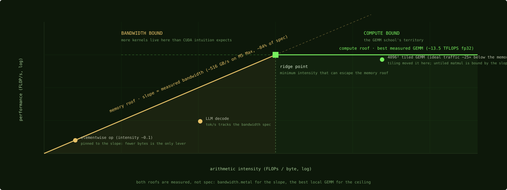

# Build your own roofline

## Where we are

Chapter 9 gave you a time and a rate: MPS at 11.7 TFLOPS for the running example.
A rate on its own says nothing about how good it is. The roofline is the model
that turns a measured rate into a verdict: how far the kernel is from the physical
limit, and which limit. Nsight Compute draws this chart for you on NVIDIA. Here
there is no tool that draws it, so you assemble it yourself from two measurements,
and this chapter is the procedure.

## The two ceilings

A roofline has two ceilings. The bandwidth ceiling is a slope: at a given
arithmetic intensity, Chapter 3, a kernel that streams at the machine's full
bandwidth achieves intensity times bandwidth, and no more. The compute ceiling is
flat: the arithmetic units can do so many operations per second regardless of
intensity. The two cross at the ridge point, and a kernel's measured rate is a
point under one of them.

**The bandwidth ceiling: measure, do not trust the spec.** A STREAM-style probe,
large buffer copies and reads swept past the cache sizes, gives achievable memory
bandwidth. The m5-gemm harness has one, `bandwidth.metal` with `bandwidth.py`, and
it measured about 516 GB/s for a copy on an M5 Max, about 84 percent of the 614
GB/s spec, and about 495 GB/s for a read-only sweep, as Chapter 3 reported. The
measured figure is your roof. Against the spec, every kernel looks farther from
the roof than it is, since 516 / 614 is 84 percent, and a kernel that has reached
the achievable limit looks as if it still had headroom.

**The compute ceiling: from the reverse-engineered tables, or a shortcut.** The
instruction-throughput tables in metal-benchmarks give per-operation ceilings per
core; scale by the core count and the clock for the chip in front of you. For
matrix multiply there is a shortcut: the best measured matrix multiply on your
chip class is a practical ceiling. On a 40-core M5 Max that is 13.5 TFLOPS in
32-bit, the kernel of Part 4, which is why Chapter 3 used that number for the
ridge.

*The chart the two measurements produce. Everything left of the ridge is capped by
the bandwidth slope no matter how clever the arithmetic; everything right of it
answers to the compute ceiling. The example points are this book's recurring
workloads.*

## The two-line interrogation

With the ceilings in hand, every benchmark result gets the same two questions,
in the same units: operations per second against the compute roof, bytes per
second against the bandwidth roof.

    achieved GFLOPS / compute ceiling in GFLOPS
    achieved GB/s   / bandwidth ceiling in GB/s

The higher ratio names the tighter of the two modeled bounds, which is the ridge
comparison of Chapter 3 in another form, since the time cancels out of the
division. It does not prove the kernel has reached that bound; a ratio near 1
does. Run it on the running example at 4096 by 4096. The benchmark computes
alpha × A × B + beta × C, so it reads C as well as writing it: the compulsory
traffic is 4 × 4096² × 4 bytes, 256 MiB, which in 10.2 milliseconds is about 26
GB/s, and 26 / 516 is about 5 percent of the bandwidth roof. The compute ratio is
13,500 / 13,500. That ratio is 1 by construction, because this kernel's result
defines the practical ceiling; it says that no measured 32-bit kernel on this
chip does better, not that the arithmetic units are proven saturated. MPS at the
same size is 11,700 / 13,500, about 0.87. The requested traffic of Chapter 3's 16
FLOPs per byte would be 13,500 / 16, about 844 GB/s, more than the DRAM roof, so
at least 1 - 516 / 844, about 39 percent, of the requested bytes were served by
the caches rather than by memory; the true share is unknown, because none of
these counts is a measurement of DRAM traffic.

If both ratios are low, the kernel is far from both references, and the ratios
alone do not say why. The candidates are dispatch and synchronization overhead,
Chapter 7, which only shows up if the timing interval includes it; spills and
occupancy, Chapters 2 and 4; instruction dependencies; or a memory level the
model does not include. That is the case where you stop reasoning from
arithmetic and go look at what the compiler emitted, Chapter 26.

## Platform hygiene, learned the hard way

Three rules from the measured failures of Part 7, each of which turned a kernel
number into a wrong claim.

**Thermals are part of the model.** Fanless and laptop chips can lose clock speed
under sustained load when they hit their thermal or power limits. One project measured its long-run throughput decay dropping from
50 percent to 6.7 percent by locking the fans at maximum, and Chapter 25 has the
command. Report sustained numbers, not first-second numbers.

**The winner moves with problem size.** The ceilings of a machine do not change
with the matrix size, but which kernel is nearest them does: the matrix multiply
ladder of Chapter 14 has a different winner at three sizes, and its author's
explanations, launch latency at small sizes, unroll quality in the middle, and
convergence at large sizes, are hypotheses from differential benchmarking rather
than isolated measurements. A roofline claim without a size sweep is a guess,
and this is the reason the running example carries its size with it.

**Report end to end as well as per kernel.** A kernel at 90 percent of its
roofline that is 3 percent of the run time buys almost nothing: Amdahl's law says
the whole program's speedup is limited by the share of time the improved part
takes, so lifting that kernel to 100 percent gives 1 / (0.97 + 0.03 × 0.9), about
a 0.3 percent improvement, and deleting it outright gives 1 / 0.97, about 3
percent. Amdahl's law kills more optimizations on this platform than physics
does, and Chapter 25 lists the measured cases.

## Where the matmul stands

The 4096 by 4096 example has a chart now. The bandwidth roof is 516 GB/s
measured, the compute roof is 13.5 TFLOPS, and the ridge is about 26 FLOPs per
byte. MPS sits at 11.7 TFLOPS, 11.7 / 13.5 is about 87 percent of the compute
ceiling, on the compute side. The target for Part 4 is the ceiling itself.

## Check yourself

1. A kernel reports 95 percent of peak bandwidth using the 614 GB/s spec. What is
   its achieved bandwidth, and what percentage is that of the measured copy roof?
2. A kernel achieves 2 TFLOPS and 30 GB/s of measured traffic on an M5 Max with
   the ceilings above. What do the two ratios say, and what do they not say?
3. A kernel's time is measured once, in the first second after launch, on a
   fanless MacBook Air, and reported as the kernel's performance. Name two
   hygiene rules the report breaks.

### Answers

1. 0.95 × 614 is about 583 GB/s, which against the measured roof is 583 / 516,
   about 113 percent. A result above an empirical roof means one of the two
   numbers needs checking: the byte count, which may count requests the caches
   served, or the roof, which this kernel may genuinely exceed.
2. 2,000 / 13,500 is about 0.15 and 30 / 516 is about 0.06. The kernel is far
   from both references, and the intensity 2,000 / 30, about 67 FLOPs per byte,
   puts it on the compute side of the ridge. The ratios do not say why it is far:
   overhead, spills, occupancy, dependencies, or a memory level outside the
   model, and the next step is the compiled code.
3. Thermals, because a first-second number on a fanless chip is not a sustained
   number; and the single trial, because Chapter 9 asks for several trials and a
   median or best-of. A single size is also no basis for a claim about other
   sizes.

The chart says the library is (13.5 - 11.7) / 13.5, about 13 percent, short of
the best measured result on this chip, and Part 4 writes the kernel that holds
that result.

Next: [Tiling and the cooperative load](11-tiling-and-the-cooperative-load.md)
