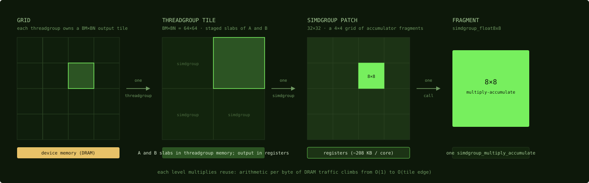

# Tiling and the cooperative load

## Where we are

Part 3 ended with a chart: MPS at 11.7 TFLOPS, about 87 percent of a 13.5 TFLOPS
ceiling, for a 4096 by 4096 matrix multiply in 32-bit on an M5 Max. Part 4 writes
the 140-line kernel that reaches the ceiling, one technique at a time, and reads
the real kernel's code as it goes. The kernel is `sync_copy.metal` from
yaroslavvb/m5-gemm, BSD-3-Clause, and every excerpt is quoted from the pinned
commit with a link to its lines. This chapter covers the first two techniques:
how the problem is cut into tiles, and how a tile gets from device memory into
the core.

## Tiling: the reuse pyramid

Chapter 3 said that a matrix multiply is compute bound only if the data reuse is
real, and that a kernel with no tiling issues n loads for every input value.
Tiling is the technique that makes the reuse real, and your CUDA instincts
transfer: copy a block of the problem one level closer to the arithmetic units,
do all the math that block supports, then let it go. What changes on this
platform is the shape of the pyramid, because the memory hierarchy of Chapter 2
has different proportions.



*Reading left to right zooms in one level per panel. The strip under each panel
names the memory that holds it; the highlighted cell is what the next panel
magnifies.*

Each level multiplies reuse. A value loaded once into threadgroup memory feeds
every simdgroup in the threadgroup; a fragment loaded once into registers feeds a
whole row or column of accumulators. In the kernel this book follows, the levels
are fixed by three compile-time constants.

```metal
constant constexpr ushort BM = SW * SIMD_TILE * 8;  // threadgroup output rows
constant constexpr ushort BN = SW * SIMD_TILE * 8;  // threadgroup output cols
constant constexpr ushort BK = TILE_K * 8;          // reduction tile
```
Source: [`sync_copy.metal:18-20`](https://github.com/yaroslavvb/m5-gemm/blob/29414bebb522ddacaa009959f2bcdad9f5b3e5cf/sync_copy.metal#L18-L20)

`SW`, `SIMD_TILE` and `TILE_K` arrive as `-D` defines, Chapter 8. With the
defaults, `SW` = 2, `SIMD_TILE` = 4 and `TILE_K` = 2: the threadgroup computes a
64 by 64 patch of the output, `BM` = `BN` = 2 × 4 × 8; its 2 × 2 = 4 simdgroups
each own a 32 by 32 quarter; and the shared dimension is consumed 16 values at a
time, `BK` = 2 × 8. The 8 in every product is the edge of the 8 by 8 fragment that
Chapter 12 introduces. Those are the three levels of the pyramid for this kernel:
threadgroup tile, simdgroup patch, fragment.

Three of the calibrations differ from CUDA habits.

**The middle level is thin.** Threadgroup memory caps tiles at 32 KB, so typical
shapes are 64 by 64 outputs with a shared-dimension slab 16 to 32 deep, smaller
than CUDA-typical. The pyramid's weight shifts down a level: register blocking,
Chapter 12, carries more of the reuse than shared-memory blocking does on NVIDIA.
Chapter 2 counted it: 8 KB of inputs passing through scratch, 16 KB of outputs
resident in registers.

**Tile shapes are compile-time.** Whether through `-D` defines, as here, or
through template parameters, as in steel, Chapter 18, the sizes are baked in so
that the loops fully unroll and the register allocator can plan. The host picks
the variant for each shape, Chapter 17.

**The edge is handled at pipeline time, not per thread.** Instead of every thread
guarding every access, function constants compile separate aligned and ragged
pipelines, Chapter 8, and the aligned one contains no bounds checks. This kernel
takes the simplest position: it requires sizes divisible by 64 and has no ragged
path at all. Steel's loader has both.

## The cooperative load

A tile has to get from device memory into threadgroup memory, and on this
platform there is exactly one way to move it: the threads of the threadgroup copy
it, together. In a cooperative load the whole threadgroup copies a tile jointly,
and no thread loads "its own" data; every thread carries an equal, coalesced
share of everyone's. It is the same staging loop as in a tiled CUDA matrix
multiply, and two platform facts make it matter more here. There is no
`cp.async`-style copy engine, Chapter 14, so cooperative loads are the only way
tiles move. Barriers are nearly free, Chapter 7, so the sequence of load, sync,
compute, sync costs almost nothing beyond the loads themselves.

Here is the reference implementation.

```metal
template <ushort rows, ushort cols, ushort nthreads>
inline void load_tile(
    const device float *src,
    uint src_stride,
    threadgroup float *dst,
    ushort tid)
{
  ...
    constexpr ushort cols4 = cols / 4;
    constexpr ushort total4 = rows * cols4;
    auto src4 = reinterpret_cast<const device float4 *>(src);
    auto dst4 = reinterpret_cast<threadgroup float4 *>(dst);
    uint stride4 = src_stride / 4;
#pragma clang loop unroll(full)
    for (ushort i = 0; i < total4; i += nthreads) {
      ushort idx = i + tid;
      if (idx >= total4) break;
      ushort r = idx / cols4;
      ushort c = idx - r * cols4;
      dst4[idx] = src4[uint(r) * stride4 + c];
    }
```
Source: [m5-gemm `sync_copy.metal:46-71`](https://github.com/yaroslavvb/m5-gemm/blob/29414bebb522ddacaa009959f2bcdad9f5b3e5cf/sync_copy.metal#L46-L71), abridged

Read the loop. The tile is treated as `total4` units of four floats, `float4`;
that is the vectorization. Thread `tid` takes unit `tid`, then unit `tid +
nthreads`, and so on, so at every step the threads of the threadgroup touch
consecutive units. That is the coalescing, and it holds on the read from device
memory and on the write into threadgroup memory alike. The division by `cols4` turns a unit
index into a row and a column, so the same loop serves a 64 by 16 tile of A and a
16 by 64 tile of B. The `break` handles a tile whose unit count is not a multiple
of the thread count; with the sizes here it never fires.

Count the work. A 64 by 16 tile is 1,024 floats, which is 256 `float4` units.
With 128 threads, that is two units per thread: two loads and two stores each,
and the whole staging step is a few hundred instructions across the threadgroup.
The `#pragma clang loop unroll(full)` and the `ushort` indices are the
micro-optimizations of Chapters 4 and 6: the trip count is a compile-time
constant, so the loop disappears, and the index arithmetic runs in 16-bit.

The rules of thumb are all familiar from CUDA. Map consecutive threads to
consecutive addresses in both directions, since coalescing matters on the
device-memory read and bank-friendliness on the threadgroup-memory write, Chapter
2. Vectorize to `float4` or `half8` when the layout permits. Derive the
thread-to-tile mapping at compile time so the loop fully unrolls.

The production version of this loop is steel's `BlockLoader`, Chapter 18. It
derives the same arithmetic, elements per thread and the thread-to-tile mapping,
from template parameters at compile time; it expresses the vector width as an
`alignas` struct so the compiler emits the widest legal load; and it adds a
bounds-checked `load_safe` twin for ragged edges, selected per pipeline by function
constants so that aligned dispatches never pay for the checks.

Older code looks different for a historical reason. Before Metal 4, a
single simdgroup could issue one copy for the whole threadgroup through an
undocumented intrinsic, and the hardware copy engine did the moving. That was
faster than any cooperative load, and it no longer compiles. Chapter 14 covers
it.

## Where the matmul stands

The problem is cut into 64 by 64 output tiles, 64 × 64 = 4,096 threadgroups for
the 4096 by 4096 example, each of 128 threads. Each threadgroup walks the shared
dimension in 256 steps of 16, staging a 64 by 16 tile of A and a 16 by 64 tile of
B per step with the cooperative load above, 8 KB per step. There is no number
yet, because the multiply that consumes the staged tiles is in the next chapter.

## Check yourself

1. With `SW` = 2, `SIMD_TILE` = 4 and `TILE_K` = 2, what are `BM`, `BN`, `BK` and
   the number of threads per threadgroup, and how many threadgroups does a 4096 by
   4096 output need?
2. The load loop uses `i += nthreads` rather than giving each thread a contiguous
   run of units. What property does the stride buy, on which memory, and why does
   it matter on this platform in particular?
3. A port keeps the cooperative load but switches the tile to 64 by 24 floats.
   How many `float4` units per thread is that with 128 threads, and which line of
   the loop handles the remainder?

### Answers

1. `BM` = `BN` = 2 × 4 × 8 = 64, `BK` = 2 × 8 = 16, and 2 × 2 simdgroups of 32
   threads is 128 threads. The output has (4096 / 64)² = 4,096 tiles, so 4,096
   threadgroups.
2. Coalescing: at each step consecutive threads read consecutive `float4` units
   from device memory and write consecutive units into threadgroup memory. It
   matters here because scattered threadgroup-memory access is comparatively
   expensive, Chapter 2, and because there is no copy engine to hide a poor
   pattern.
3. 64 × 24 = 1,536 floats, 384 units, 3 per thread, so the loop runs three times
   and the `if (idx >= total4) break;` line never fires; it would fire if the unit
   count were not a multiple of 128.

The staged tiles are in threadgroup memory; the next chapter pulls them into
registers eight by eight and multiplies there, which is where the kernel's number
comes from.

Next: [simdgroup_matrix and register blocking](12-simdgroup-matrix-and-register-blocking.md)
