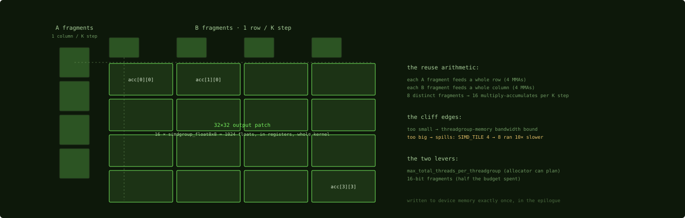

# simdgroup_matrix and register blocking

## Where we are

Chapter 11 staged a 64 by 16 tile of A and a 16 by 64 tile of B in threadgroup
memory, 8 KB per step, and left them there. This chapter multiplies them. Two
things happen: the multiply itself runs through Metal's matrix primitive, which
looks like NVIDIA's warp-level matrix API and is not the same hardware; and the
results stay in registers across all 256 steps of the shared dimension, which is
register blocking, the technique the proportions of Chapter 2 favor. At the end of
the chapter the kernel has its number.

## simdgroup_matrix: the API of a Tensor Core, on the regular pipes

`simdgroup_matrix<T, 8, 8>` is Metal's matrix-multiply primitive: an 8 by 8 matrix
held collectively in one simdgroup's registers, with a single call that multiplies
and accumulates. As an API it is warp-level matrix multiply-accumulate, the `wmma`
fragments or `mma.sync` of CUDA. As hardware the analogy is looser. Apple GPUs
before M5 have no separate Tensor Core unit; `simdgroup_matrix` operations execute
on the regular 32-bit pipes, arranged well. The reverse-engineered Rigel paper
confirms that even Metal 4.1's newer `matmul2d` tensor API has no dedicated matrix
datapath on M4-class hardware. So the performance story differs from NVIDIA's. You
use `simdgroup_matrix` for its register layout and issue efficiency, not for a
tenfold throughput unlock, and a well-written kernel built on it still reaches the
compute ceiling of Chapter 10. On M5 the story forks: a real per-core matrix unit
arrives, reached through Metal 4 tensor operations, and Part 8 covers it.
`simdgroup_matrix` remains the portable primitive that runs on every M-series chip
and that most shipped kernels use.

Here is the whole API in one loop, from the kernel this book follows.

```metal
simdgroup_float8x8 A_simd, B_simd;
#pragma clang loop unroll(full)
for (ushort i = 0; i < DIM * 8; i += 8) {
  simdgroup_load(A_simd, A, DIM * 8, ulong2(i, c_pos.y));
  simdgroup_load(B_simd, B, BN,      ulong2(c_pos.x, i));
  simdgroup_multiply_accumulate(acc, A_simd, B_simd, acc);
}
```
Source: [m5-gemm `sync_copy.metal:29-35`](https://github.com/yaroslavvb/m5-gemm/blob/29414bebb522ddacaa009959f2bcdad9f5b3e5cf/sync_copy.metal#L29-L35)

Load a fragment of A and a fragment of B from threadgroup memory, multiply and
accumulate into `acc`, advance 8 along the shared dimension, repeat. Three rules
of use, all matching your `wmma` instincts.

- **Fragments are opaque.** You never index into a `simdgroup_float8x8`; its 64
  elements live distributed across the 32 threads in an undocumented layout.
  `simdgroup_load` and `simdgroup_store` move whole tiles between a fragment and
  threadgroup or device memory.
- **Fragments are registers, and they add up.** A 4 by 4 grid of accumulators is
  16 fragments of 64 floats, 1,024 floats per simdgroup, Chapter 2. The
  accumulator budget is the tile-size decision.
- **Types.** `simdgroup_float8x8`, `simdgroup_half8x8`, `simdgroup_bfloat8x8`. 16-bit
  fragments halve the register cost, and the kernels of Parts 5 and 6 take 16-bit
  inputs and accumulate in 32-bit, Chapter 4. This kernel is a 32-bit benchmark
  and uses `float` throughout.

Everything above `simdgroup_matrix` is composition. Steel's `BlockMMA`, Chapter
18, tiles these fragments into a simdgroup-level register block; the attention
kernels of Part 6 chain two such blocks through an online softmax. When a problem
has only one row, as in decode, no 8 by 8 tile can be filled and kernels abandon
`simdgroup_matrix` entirely, which is the split of Chapter 22.

## Register blocking: the output never leaves the register file

Register blocking keeps each simdgroup's patch of the output resident in
registers for the kernel's entire lifetime: accumulate across every step of the
shared dimension, write to memory exactly once. It is the accumulator-fragment
idea of any warp-tiled CUDA matrix multiply. The difference is proportion: with
about 208 KB of registers against 32 KB of threadgroup memory, Apple kernels push
more of the working set into registers than CUDA-typical, and the technique's
failure mode, spilling, is correspondingly worse.

In its simplest real form, each simdgroup owns a 4 by 4 grid of accumulators.

```metal
  simdgroup_float8x8 acc[SIMD_TILE][SIMD_TILE];
  for (ushort i = 0; i < SIMD_TILE; i++)
    for (ushort j = 0; j < SIMD_TILE; j++)
      acc[i][j] = simdgroup_float8x8(0);
```
Source: [m5-gemm `sync_copy.metal:104-107`](https://github.com/yaroslavvb/m5-gemm/blob/29414bebb522ddacaa009959f2bcdad9f5b3e5cf/sync_copy.metal#L104-L107)



*The reuse geometry: eight fragment loads feed sixteen multiply-accumulates per
step, and the accumulator grid never leaves the register file.*

Count the reuse, because it is the reason the grid is 4 by 4 and not 1 by 1. Per
step of 8 along the shared dimension, the simdgroup loads 4 fragments of A, one
per row of the grid, and 4 fragments of B, one per column: 8 loads from
threadgroup memory. They feed 4 × 4 = 16 multiply-accumulates. Every fragment
loaded is used four times. With a 1 by 1 grid, each step would load 2 fragments
for 1 multiply, and the simdgroup would be limited by threadgroup-memory
bandwidth instead of arithmetic. That is the "too small" cliff.

The "too big" cliff is the one Chapter 2 introduced. The author tried `SIMD_TILE`
= 8, an 8 by 8 grid, 64 fragments, a 64 by 64 patch per simdgroup, and the kernel
ran 10 times slower, not 10 percent, because the accumulators spilled. Once an
accumulator is spilled, the multiply-accumulate that updates it is wrapped in a
load and a store, and the loop is no longer arithmetic. The cliff is sharp
because the payload crosses the per-thread budget the compiler set, Chapter 2,
and the 4 by 4 grid is the largest that stays under it on this kernel. The
register-pressure levers from Chapter 2 follow: 16-bit fragments to halve the
budget spent, and the attribute below.

## The most consequential line

The kernel's single biggest practical win, in its author's words, is an attribute
on the kernel declaration.

```metal
kernel void __attribute__((max_total_threads_per_threadgroup(SW * SW * 32)))
matmul(
```
Source: [`sync_copy.metal:84-85`](https://github.com/yaroslavvb/m5-gemm/blob/29414bebb522ddacaa009959f2bcdad9f5b3e5cf/sync_copy.metal#L84-L85)

With `SW` = 2 the bound is 128 threads. Chapters 1, 7 and 8 said what it does:
the compiler allocates registers when it builds the pipeline, and without the
bound it must plan for the hardware maximum and give each thread fewer. With it,
the allocator commits to a budget for 128 threads, and the 16 accumulators per
simdgroup stop spilling. The author's measurement is the one Chapter 2 quoted and
the one every later chapter refers back to; it is one line.

Now the loop that ties the three chapters together, the step over the shared
dimension.

```metal
  uint k_tiles = k / BK;
  for (uint l = 0; l < k_tiles; l++) {
    uint k_off = l * BK;
    load_tile<BM, BK, NTHREADS>(A + tg_row * k + k_off, k, A_tg, tid_in_tg);
    load_tile<BK, BN, NTHREADS>(B + k_off * m + tg_col, m, B_tg, tid_in_tg);
    threadgroup_barrier(mem_flags::mem_threadgroup);

    ushort2 simd_origin = ushort2(t_tg_pos.y, t_tg_pos.z) * (8 * SIMD_TILE);
    for (ushort i = 0; i < SIMD_TILE; i++)
      for (ushort j = 0; j < SIMD_TILE; j++)
        simdgroup_multiply_tile<TILE_K>(
            A_tg, B_tg,
            simd_origin + ushort2(i * 8, j * 8),
            acc[i][j]);
    threadgroup_barrier(mem_flags::mem_threadgroup);
  }
```
Source: [`sync_copy.metal:113-128`](https://github.com/yaroslavvb/m5-gemm/blob/29414bebb522ddacaa009959f2bcdad9f5b3e5cf/sync_copy.metal#L113-L128)

Stage cooperatively, Chapter 11; barrier; multiply from registers, this chapter;
barrier; advance. `simd_origin` is where this simdgroup's 32 by 32 patch sits in
the threadgroup's 64 by 64 tile, from its position in the threadgroup. `simdgroup_multiply_tile` is the fragment loop quoted at the top
of this chapter, run `TILE_K` = 2 times per step to cover the 16-deep slab. The
two barriers are the two hazards of Chapter 2: the first waits for the slab to
arrive, the second waits for every simdgroup to finish reading it before the next
iteration overwrites it.

## Where the matmul stands

The kernel multiplies two 4096 by 4096 32-bit matrices on a 40-core M5 Max at
13.5 TFLOPS, best of 3 runs of 5 trials, against 11.7 for MPS. It beats the
library by (13.5 - 11.7) / 11.7, about 15 percent, and it sits at the practical
compute ceiling of Chapter 10, which is defined by this result. Three techniques
got it there: tiling, the cooperative load, and register blocking on
`simdgroup_matrix`, with the attribute that keeps the accumulators in registers.
The epilogue and the full reading of the file are the next chapter.

## Check yourself

1. A simdgroup with a 4 by 4 accumulator grid steps 8 along the shared dimension.
   How many fragment loads and how many multiply-accumulates does the step cost,
   and what would a 2 by 2 grid cost per multiply-accumulate?
2. Why does the kernel use `simdgroup_matrix` if the hardware before M5 has no
   matrix unit?
3. The attribute declares a maximum of 128 threads. What does the compiler do
   differently with that information, and what happened to this kernel without
   it?

### Answers

1. 4 loads of A and 4 of B, 8 loads, feeding 16 multiply-accumulates, so half a
   load per multiply-accumulate. A 2 by 2 grid loads 2 + 2 = 4 fragments for 4
   multiply-accumulates, one load per multiply-accumulate, twice the
   threadgroup-memory traffic per unit of arithmetic.
2. For its register layout and issue efficiency: the fragment is held across the
   32 threads in a layout the hardware multiplies efficiently, and the loop is a
   handful of calls per step. The gain is not a tenfold throughput unlock, and the
   kernel still reaches the compute ceiling.
3. It allocates registers for 128 threads instead of the hardware maximum, so each
   thread gets a larger budget. Without it, the accumulators spilled; the author
   calls the attribute the single biggest practical win in the kernel.

Every line of the kernel except its ending has now been explained, and the next
chapter reads the file from top to bottom, including the ending.

Next: [Reading the whole kernel](13-reading-the-whole-kernel.md)
