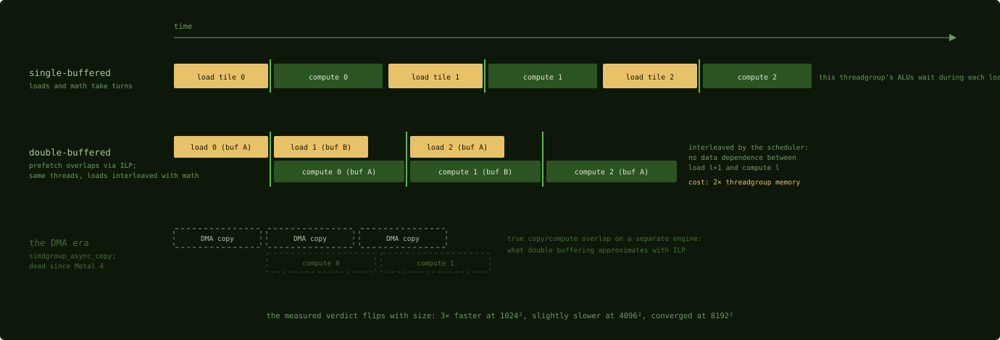
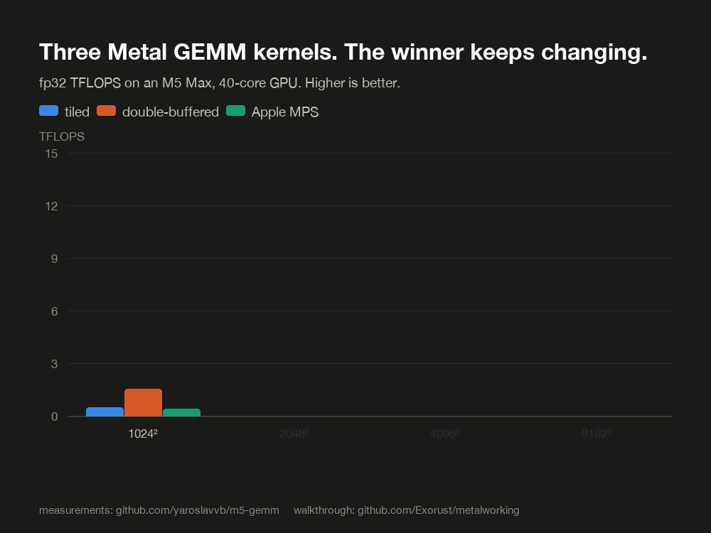

# Double buffering, and the copy engine that died

## Where we are

Chapter 13 finished reading the kernel: 13.5 TFLOPS at 4096 by 4096, at the
practical compute ceiling. This chapter asks the next question a CUDA engineer
asks of any tiled loop: the load of the next slab and the multiply of the current
one are independent, so why not overlap them? The answer on this platform comes in
two parts. There is a double-buffered version of the kernel, and it wins at some
sizes and loses at others, which is the cleanest measured demonstration in this
book that there is no single fastest kernel. The hardware copy engine that a
CUDA kernel would use for the overlap exists on the chip, was once reachable, and
can no longer be reached; the shape of every current kernel follows from that.

## Double buffering: overlap through ILP, not DMA

Double buffering allocates two staging buffers so that the loop can load slab
`l + 1` while computing on slab `l`. It is the multi-stage `cp.async` pipeline of
every modern CUDA matrix multiply, with one local difference: there is no copy
engine, so there is no true overlap of copy and compute. The same threads issue
both the loads and the math. What makes it work anyway is that the prefetch loads
and the current slab's multiply-accumulates have no data dependence, so the
hardware scheduler interleaves them. This is the instruction-level parallelism of
Chapter 4, and it hides threadgroup-memory latency with independent work from one
instruction stream. It is software pipelining rather than hardware pipelining.

The double-buffered loop differs from the single-buffered loop of Chapter 12 in
exactly three ways: two buffer sets, a prologue that loads slab 0, and one barrier per
iteration instead of two. The multiply, elided below, is the same fragment loop
as Chapter 12, run on `A_use` and `B_use`.

```metal
  threadgroup float A_tg[2][BM * BK];
  threadgroup float B_tg[2][BK * BN];
  ...
  // Prologue: load tile 0 into buffer 0.
  load_tile<BM, BK, NTHREADS>(A + tg_row * k, k, A_tg[0], tid);
  load_tile<BK, BN, NTHREADS>(B + tg_col,     m, B_tg[0], tid);

  ushort cur = 0;
  ...
  for (uint l = 0; l < k_tiles; l++) {
    threadgroup_barrier(mem_flags::mem_threadgroup);
    ushort nxt = ushort(1) - cur;
    if (l + 1 < k_tiles) {
      uint k_off = (l + 1) * BK;
      load_tile<BM, BK, NTHREADS>(A + tg_row * k + k_off, k, A_tg[nxt], tid);
      load_tile<BK, BN, NTHREADS>(B + k_off * m + tg_col, m, B_tg[nxt], tid);
    }
    threadgroup float *A_use = A_tg[cur];
    threadgroup float *B_use = B_tg[cur];
    ...
    cur = nxt;
  }
```
Source: [`sync_copy_db.metal:87-126`](https://github.com/yaroslavvb/m5-gemm/blob/29414bebb522ddacaa009959f2bcdad9f5b3e5cf/sync_copy_db.metal#L87-L126), abridged

The single barrier covers two hazards. "The prefetch has landed" and "everyone is
done with the buffer we are about to overwrite" are the same condition when the
buffers alternate, so the two hazards of Chapter 2 are covered by one barrier at
the top of each iteration. The kernel's own header comment states the mechanism:
without the copy engine there is no true overlap, only the same threads issuing
independent loads and math for the scheduler to interleave.



*What the restructuring buys. The ticks are threadgroup barriers, one per
iteration in the double-buffered loop; the ghosted third lane is the hardware
overlap the platform lost with `simdgroup_async_copy`.*

The cost is the one Chapter 4 priced. Two buffer sets double the threadgroup's
scratch footprint, 16 KB instead of 8 KB for this kernel, which halves the
scratch-limited bound on how many threadgroups a core can hold. Double buffering
trades one latency-hiding mechanism, occupancy, for another, independent work
inside each threadgroup. Whether the trade wins depends on which one the kernel
was short of.

## Three sizes, three winners

The author measured the single-buffered kernel, the double-buffered kernel and
MPS at four sizes on an M5 Max, 32-bit, best of 3 runs of 5 trials.

| Size | sync_copy | sync_copy_db | MPS |
|---:|---:|---:|---:|
| 1024² | 3.3 TF | 10.7 TF | 2.9 TF |
| 2048² | 7.7 TF | 9.0 TF | 5.2 TF |
| 4096² | 13.5 TF | 13.1 TF | 11.7 TF |
| 8192² | 13.0 TF | 12.7 TF | 13.5 TF |



Each size regime has a different winner. The author's explanations for each are
hypotheses from differential benchmarking rather than isolated measurements. At
1024 by 1024, the double-buffered kernel is 10.7 / 3.3, about 3.2 times the
single-buffered one and 10.7 / 2.9, about 3.7 times MPS: at this size launch and
memory-fetch latency dominate, and the prefetch pipeline hides them. Language-model
decode runs in this size regime (Chapter 22). At 4096 by
4096 the simpler kernel wins by a little, 13.5 against 13.1, because its smaller
loop unrolls better; compiler quality matters more than the algorithm here. At
8192 by 8192 all three converge, 13.0, 12.7 and 13.5, and MPS takes the lead
back; the author attributes the convergence to the memory system, and whatever
the mechanism, the kernels are no longer separated by their inner loop.

The general result is that the ranking is non-monotonic: no single kernel is
fastest at every size. Double buffering wins in some regimes and loses in others,
which is why production libraries dispatch different variants per shape
(Chapter 17) instead of shipping one kernel.

The README's section "things that did not help" is worth reading for its method
(Chapter 9): offline compilation with `-O3 -ffast-math`, measured identical to
runtime compilation; bigger simdgroup tiles, the 10 times slower spill of Chapter
12; and `SW` = 3 threadgroups. The author measured these negative results and
published them, which is the norm that the failures in Chapter 25 argue the whole
ecosystem should follow.

## The copy engine that died

A CUDA engineer reading the double-buffered loop would ask where `cp.async` is,
and the answer is a short history. Apple's hardware has a copy engine that moves
tiles from device memory to threadgroup memory while the arithmetic units work,
with completion signaled by events: the same idea as `cp.async` and TMA. Apple
never exposed it in the Metal Shading Language. The compiler exposed it anyway,
and the community found it: an intrinsic could be declared by its internal AIR
symbol name through inline-assembly linkage.

```metal
thread _simdgroup_event_t* __metal_simdgroup_async_copy_2d(
  ulong,               // sizeof(element)
  ulong,               // alignof(element)
  threadgroup void *,  // dst
  ...
  __asm("air.simdgroup_async_copy_2d.p3i8.p1i8");

void __metal_wait_simdgroup_events(
  int, // len(events)
  thread _simdgroup_event_t**
)
  __asm("air.wait_simdgroup_events");
```
Source: [metal-matmul `async_copy.metal:9-28`](https://github.com/0xekez/metal-matmul/blob/04e80810bbf7ba96ebe26ff84a346d179ee50888/async_copy.metal#L9-L28), abridged

Then you used it like `cp.async`: start the copy, compute, wait on the event. The
original of this book's matrix-multiply lineage, Zeke Medley's metal-matmul and
its essay, was built on it. The use site is the more interesting part.

```metal
    if (s_pos==0) {
      thread _simdgroup_event_t* events[2];
      events[0] = simdgroup_async_copy<TILE_K*8,SW*SIMD_TILE*8>(
        A,
        a_pos,
        ushort2(k,n),
        A_tg);
      events[1] = simdgroup_async_copy<SW*SIMD_TILE*8,TILE_K*8>(
        B,
        b_pos,
        ushort2(m,k),
        B_tg);
      __metal_wait_simdgroup_events(2,events);
    }
    threadgroup_barrier(mem_flags::mem_threadgroup);
```
Source: [`async_copy.metal:101-115`](https://github.com/0xekez/metal-matmul/blob/04e80810bbf7ba96ebe26ff84a346d179ee50888/async_copy.metal#L101-L115)

Read `if (s_pos==0)`: one simdgroup issues the copy for the whole threadgroup,
fires both transfers, waits on the events, and everyone else waits at the
barrier. The essay's counterintuitive measurement was that this was the fastest
arrangement, because the copy engine does the moving and spreading the request
across simdgroups bought nothing. CUDA's evolution toward TMA, where one thread
issues a bulk tensor copy, reached the same conclusion with official support.
metal-flash-attention built its tile staging on the same intrinsics, and
documents an M1-era hardware bug: an async copy whose result is never read hangs
the GPU until reboot. That is the risk of building on an undocumented interface.

Metal 4, which shipped with macOS 26, removed that access. The compiler rejects every
`__asm("air.*")` declaration with the error "illegal string literal in 'asm'",
and workarounds at the intermediate-representation level crash the backend
compiler. There is no public replacement; Metal 4's cooperative tensors ship a
generic layout interface, not a copy primitive. The m5-gemm README documents the
failed attempts to resurrect it. Hence the two successor kernels you have read:
cooperative loads for the staging, Chapter 11, and double buffering to win back
most of the overlap through instruction-level parallelism, above.

There are two reasons to keep the dead code in mind. The concept outlives the interface: a
copy engine with event-signaled completion is how `cp.async` and TMA work, how
metal-flash-attention's generated kernels staged tiles, and plausibly how a future
public Metal API will look, and you will recognize it at a glance. It is also a
lesson in platform risk: every project that built on the undocumented intrinsic,
the essay, metal-flash-attention, early steel, carried a breakage risk that
Metal 4 made real. The cheap wins of Chapter 25 run the same trade knowingly, with
undocumented `sysctl` settings and private frameworks, and this kernel shows what the
downside looks like.

## Where the matmul stands

The example now has a family: at 1024 by 1024 the double-buffered kernel wins by
about 3 times, at 4096 by 4096 the single-buffered kernel holds 13.5 TFLOPS, and
at 8192 by 8192 the library catches up at 13.5. The DMA-staged original no longer
compiles. The matmul has no further technique to gain from its own loop; the
remaining gains are in what surrounds it, which is the next chapter.

## Check yourself

1. The double-buffered kernel uses one barrier per iteration where the
   single-buffered kernel uses two. Which two hazards does the one barrier cover,
   and why is one enough?
2. At 1024 by 1024 the double-buffered kernel is about 3 times faster, and at
   4096 by 4096 it is slightly slower. What does the chapter say this pattern
   implies for a production library?
3. Why does a kernel written in 2024 against `simdgroup_async_copy` fail to
   compile on macOS 26, and what replaced the technique?

### Answers

1. "The prefetch into the next buffer has landed" and "every simdgroup has
   finished reading the buffer about to be overwritten". With two alternating
   buffers, both are true at the same point, the top of the iteration, so one
   barrier there covers both.
2. That no single kernel is fastest at every size, so a library should dispatch
   different variants per shape rather than ship one kernel; Chapter 17 shows MLX
   doing exactly that.
3. Metal 4's compiler rejects every `__asm("air.*")` declaration, which was the
   only way to reach the intrinsic. Cooperative loads replaced the staging and
   double buffering, through instruction-level parallelism, replaced most of the
   overlap.

The loop is settled, and what surrounds it is where the next gains are: the
operations before and after a matrix multiply that, done separately, each cost a
full pass over memory.

Next: [Fusion and epilogues](15-fusion-and-epilogues.md)
