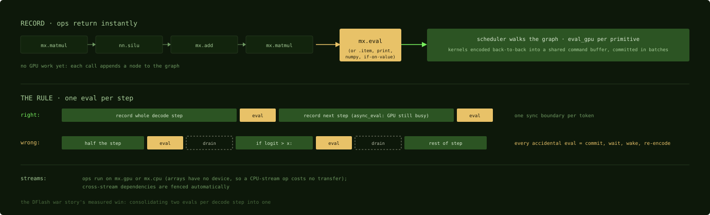

# Arrays that record: MLX and lazy evaluation

## Where we are

Part 4 wrote a matrix multiply by hand and timed it through a Python harness that
spoke to Metal directly. Almost nobody runs a model that way. On Apple Silicon you
usually optimize through MLX, Apple's open-source array framework, and its
architecture decides what is fast before any kernel runs. Part 5 follows the same
matrix multiply into MLX: what the framework does with `mx.matmul(a, b)` before,
during and after the kernel. This chapter covers the before. At that stage MLX
does no work at all, and the chapter explains why that design matters.

## What MLX is, for a CUDA-stack reader

MLX is a NumPy-shaped array API with automatic differentiation, built natively on
the unified memory of Chapter 3, whose GPU backend is the steel kernel library
that Chapter 18 reads. In CUDA terms it is the whole stack of PyTorch, cuBLAS and
cuDNN, and bits of Triton, collapsed into one codebase, which is why this book
gives it a part rather than a chapter.

Four CUDA expectations need recalibrating.

**Arrays have no device.** An `mx.array` lives in unified memory. There is no
`.to("gpu")` and no host-to-device copy anywhere in user code. Operations have a
location instead, a stream on a device, so the CPU and the GPU can work on the
same buffers: quantize on the CPU while the GPU decodes, in one address space.

**Everything is lazy.** Operations build a graph; computation happens at
`mx.eval`. The purpose is less the compiler work that `torch.compile` does than
the dispatch batching of Chapter 7, and on this platform performance depends on
it.

**Function transforms, not an autograd tape.** `mx.grad`, `mx.vmap` and
`mx.compile` compose like JAX's transforms. Training works, but most of the
ecosystem's effort goes into inference.

**The kernels are readable.** Unlike cuBLAS, the fast path is open-source Metal
Shading Language you can read: steel for matrix multiply and attention, the
quantized kernels for language-model weights, Chapter 23, and an escape hatch for
your own kernels, Chapter 21.

The layer map, top to bottom, with the chapter for each layer:

    Python (mx.*)                       NumPy-shaped API, lazy
      graph + scheduler                 this chapter: batches work into command buffers
        primitives (eval_gpu)           Chapter 17: C++ picks a kernel and tile sizes
          steel / quantized / fast MSL  Chapters 18, 21, 23: the kernels
            Metal                       Part 2

Where the alternatives sit: llama.cpp's Metal backend, Chapter 21, is the other
production-grade kernel body on the platform, C and C++ with no Python layer,
organized around quantized formats. PyTorch's MPS backend runs and is improving,
and since version 2.13 ships hand-written Metal kernels for hot paths such as
FlexAttention rather than dispatching everything to the library of Chapter 9; it
remains a port of a CUDA-native design. MLX also has a CUDA backend now, which
makes it a two-backend framework. MLX's Metal backend is still where kernel-level
work happens if you want to touch the stack this book teaches.

## Operations record; evaluation runs

`mx.matmul(a, b)` does not compute. It returns at once with a graph node, and the
GPU work happens when something forces evaluation. That deferral is what lets MLX
batch an entire model into few command buffers.

The nearest CUDA-side idea is PyTorch's asynchronous dispatch, and this is
stronger. PyTorch enqueues each operation eagerly and hides latency with stream
asynchrony; MLX does not even decide anything until evaluation, so it can see a
whole subgraph and schedule it as a unit. It is less like CUDA Graphs than it
looks, because there is no capture-and-replay lifecycle, but the payoff is
similar: per-operation CPU overhead and per-launch GPU overhead are amortized,
which matters doubly on a platform where the cost of a wait, Chapter 3, dominates
performance.

Evaluation is forced by `mx.eval(arrays...)`, or implicitly by anything that
needs values: printing, `.item()`, converting to NumPy, or a control-flow branch
on an array's contents. At that point the scheduler walks the graph and calls
each primitive's `eval_gpu`, Chapter 17, encoding kernel after kernel into a
shared command buffer and committing when a batch quantum fills.

```cpp
void eval(array& arr) {
  auto pool = metal::new_scoped_memory_pool();
  auto s = arr.primitive().stream();
  auto& encoder = metal::get_command_encoder(s);
  ...
    arr.primitive().eval_gpu(arr.inputs(), outputs);
  ...
  if (encoder.needs_commit()) {
    encoder.end_encoding();
    scheduler::notify_new_task(s);
    encoder.commit([s, buffers = std::move(buffers)]() {
```
Source: [`mlx/backend/metal/eval.cpp:29-62`](https://github.com/ml-explore/mlx/blob/47bbfe8fa473d6d19037a8d97f1f7d30514e4cf6/mlx/backend/metal/eval.cpp#L29-L62), abridged

The encoder is shared across primitives on a stream, the
primitive encodes its dispatch into it, and the commit happens only when the
encoder says it needs one, which MLX decides from its own thresholds of work and
memory. This is the batching rule of Chapter 7 applied automatically, and it is
also the opt-out Chapter 7 mentioned: MLX allocates its buffers untracked and
dispatches concurrently, so it inserts the memory barriers between dependent
dispatches itself rather than relying on Metal's hazard tracking.



*Recording is free; evaluation is the synchronization boundary. The bottom lanes
show the same loop written well and badly: the dashed drains are what an
accidental evaluation in the middle of the loop costs on every token.*

## The rule that falls out: evaluate once per step

Every `mx.eval`, explicit or accidental, is a synchronization boundary: commit,
wait, the CPU wakes, re-encode. The DFlash case of Chapter 25 measured a real
speedup from consolidating two evaluations per decode step into one. The classic
accidental version is a Python `if` on a logit value in the middle of the loop,
which forces a pipeline drain per token. Structure loops so that exactly one
evaluation happens per iteration, at the end.

Streams are where operations run. `mx.gpu` and `mx.cpu` are the default streams
on their devices, `mx.new_stream(device)` makes more, and every operation takes a
`stream=` argument. Because arrays have no device, sending an operation to the
CPU stream costs no transfer, so heterogeneous pipelines, CPU pre-processing and
post-processing around GPU compute, are routine. Dependencies
across streams are fenced by the scheduler.

Laziness also enables `mx.compile`, Chapter 19: since the graph exists anyway, it
can be traced, fused and cached.

## Where the matmul stands

The same 4096 by 4096 multiply, written as `mx.matmul(a, b)`, is now a node in a
graph and has done nothing. When `mx.eval` runs, the scheduler will hand it to the
matrix-multiply primitive, which picks the kernel and tile sizes in the next
chapter.

## Check yourself

1. A decode loop calls `mx.eval(logits)` at the end of each step and also has a
   Python `if logits[0, i] > 0.5:` in the middle. How many synchronization
   boundaries does each step pay, and what does the chapter say to do?
2. In what sense is MLX's laziness stronger than PyTorch's asynchronous dispatch,
   and in what sense is it weaker than CUDA Graphs?
3. Why can a CPU pre-processing step be placed on `mx.cpu` without a transfer
   cost?

### Answers

1. Two: the `if` forces an evaluation in the middle, and the `mx.eval` forces one
   at the end. Restructure so the loop evaluates once, at the end, which halves
   the drains per token, the measured DFlash win.
2. Stronger because MLX decides nothing until evaluation and can schedule a whole
   subgraph as a unit, while PyTorch enqueues each operation as it comes. Weaker
   than CUDA Graphs in that there is no capture-and-replay lifecycle; the payoff
   of amortized overhead is similar.
3. Because arrays have no device: the array lives in unified memory, and the CPU
   and the GPU read the same bytes, so only the operation moves, not the data.

The scheduler has handed the matrix multiply to its primitive, and the next
chapter reads the one C++ hop between the graph node and a kernel: the code that
picks the variant and the tile sizes.

Next: [How an op becomes a kernel](17-how-an-op-becomes-a-kernel.md)
