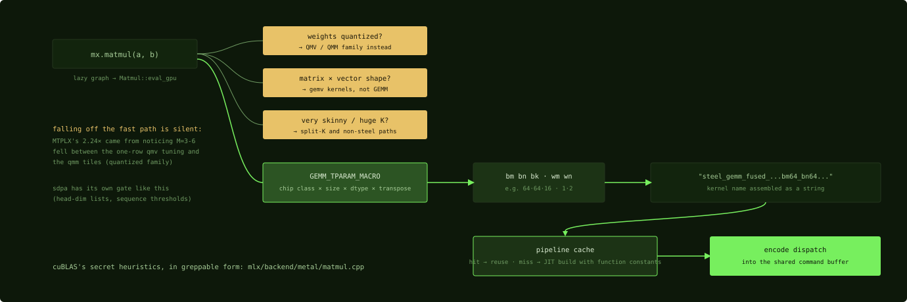

# How an op becomes a kernel

## Where we are

Chapter 16 left the matrix multiply as a graph node that the scheduler hands to
its primitive at evaluation time. Between that node and a `simdgroup_matrix`
instruction sits one C++ hop: the primitive's `eval_gpu`, which picks a kernel
variant, picks tile sizes, binds function constants, and encodes the dispatch.
In CUDA this is the dispatcher layer between PyTorch and cuBLAS's heuristics,
except that here the code is open, small and readable. Once you know where these
decisions live, you can turn "my model is slow" into "my shapes fall off the fast
path". The second of the three questions of Chapter 24, unlock an existing fast
path, is answered by reading exactly these files.

## The chain, for a matmul

The lazy graph hands `Matmul` to the scheduler. `Matmul::eval_gpu`, in
`mlx/backend/metal/matmul.cpp`, normalizes strides and transposes, then picks
the steel template parameters from the device class and the problem shape.

```cpp
#define GEMM_TPARAM_MACRO(devc)                                           \
  if (devc == 'g' || devc == 'p') { /* Small device */                    \
    ...
  } else if (devc == 'd') { /* Large device */                            \
    if ((size_t)batch_size_out * M * N >= 1ul << 20) { /* large matmul */ \
      if (out.dtype() != float32) { /* half and bfloat */                 \
        if (2 * std::max(M, N) > K) { /* Reasonable K */                  \
          bm = 64;                                                        \
          bn = 64;                                                        \
          bk = 16;                                                        \
          wm = 1;                                                         \
          wn = 2;                                                         \
        } else if (!transpose_a && transpose_b) { /* nt with large k */   \
          bm = 64;                                                        \
          bn = 32;                                                        \
          bk = 32;                                                        \
          wm = 2;                                                         \
          wn = 2;                                                         \
```
Source: [`mlx/backend/metal/matmul.cpp:89-124`](https://github.com/ml-explore/mlx/blob/47bbfe8fa473d6d19037a8d97f1f7d30514e4cf6/mlx/backend/metal/matmul.cpp#L89-L124), abridged

Read what that macro is: a hand-tuned lookup from the chip class, the size, the
data type and the transpose pattern to a tile shape, `bm`, `bn`, `bk`, `wm`, `wn`.
Those are the `BM`, `BN`, `BK` of Chapter 11 and the simdgroup arrangement of
Chapter 12, chosen per shape instead of fixed by `-D` defines. It does the job of
cuBLAS's secret heuristics, but you can search it. The device class letter is the
last character of the Metal architecture name, and `device.cpp` spells out the
mapping: `p` for phone, `g` for base and Pro chips, `s` for Max, `d` for Ultra.
The macro's small-device branch is `g` and `p`; its large-device branch is `d`,
the Ultra. A Max matches neither, so an M5 Max keeps the defaults set just
before the macro, `bm` = `bn` = 64, `bk` = 16, `wm` = `wn` = 2: a 64 by 64 tile,
16 deep, four simdgroups of 32 by 32, which is exactly the hand-written kernel's
shape. On an Ultra, the first row shown gives 16-bit matrices of a reasonable
shape a 64 by 64 tile, 16 deep, with 1 by 2 simdgroups, two simdgroups of 64
rows by 32 columns; the second row changes the tile for the transposed-B case
with a large shared dimension. The branches continue past the excerpt for
smaller matmuls, and a 32-bit large matmul on an Ultra also takes the defaults,
which the file comments mark with "float takes default".

Then the kernel name is assembled as a string, `steel_gemm_fused_...bm64_bn64...`
and so on. The pipeline is fetched from the cache or built at run time (Chapter
6), the alignment function constants of Chapter 8 are bound, and the dispatch is
encoded into the shared command encoder of Chapter 16.



*The route a matmul takes. The amber branches are where shapes silently leave
the steel fast path; the green spine is the path Chapter 18 reads.*

## The branches before steel

Several branches come before the macro, and a shape that falls into the wrong
one runs slower without any warning.

- **Matrix-vector shapes** route to `gemv` kernels rather than to the tiled
  matrix multiply, because one row cannot fill a tile (Chapter 22).
- **Very skinny or small cases** have split-K and other non-steel paths.
- **Quantized weights** go to a different kernel family (Chapter 23),
  whose fast path is shape-sensitive in its own ways.
- **`mx.fast.scaled_dot_product_attention`** has its own dispatch gate deciding
  between the fused kernel and a fallback graph (Chapter 21).

The measured example of the trap is the MTPLX case of Chapter 24: 2.24 times
end-to-end from about 10 lines, which came from noticing that multi-token decode,
3 to 6 query rows at a time, fell between the matrix-vector path and the tile
sizes this macro assumes. The kernel existed, but its tuning grid had a hole.

## What this means for the kernel writer

Because the dispatcher is readable, three habits follow.

First, before writing anything, read the branch your shape takes. The question
"why is this slow" often has the answer "because it took the branch for a
different shape", and the fix is a change to the dispatch rather than a new kernel.

Second, the tile table is where production code applies the "no single fastest
kernel" lesson of Chapter 14. The table encodes which variant wins per
shape, and when a new chip generation moves the crossovers, the table moves.

Third, the pipeline cache is keyed by the assembled name and the constant values,
so a model that meets many distinct shapes pays a pipeline build for each the
first time, and MLX keeps every pipeline it builds for the life of the process.

## Where the matmul stands

For 4096 by 4096 in 32-bit on an M5 Max, the macro has no branch for the Max
class, so the defaults stand: `bm` = `bn` = 64, `bk` = 16, `wm` = `wn` = 2, the
shape of Part 4. The name `steel_gemm_fused_...` is assembled with those sizes, the `align_M`, `align_N` and
`align_K` constants bind to true because 4096 divides by the tiles, and the
aligned pipeline is dispatched. The kernel it runs is the subject of the next
chapter.

## Check yourself

1. A model runs a 4096 by 4096 matrix multiply in 16-bit with K = 64 on an M2
   Ultra. Which branch of the excerpt does it take, and which tile shape does it
   get? What changes on an M5 Max?
2. A speculative decoder sends 4 query rows at a time and runs slower per row
   than single-row decode. Which part of the dispatch chain does the chapter say
   to read first, and why?
3. Why does MLX assemble the kernel name as a string rather than calling one
   kernel?

### Answers

1. On the Ultra, device class `d`: the large-device, large-matmul branch for
   non-32-bit output, then the test `2 × max(M, N) > K`: 8192 > 64 is true, so
   the "reasonable K" row, `bm` = 64, `bn` = 64, `bk` = 16, `wm` = 1, `wn` = 2.
   On the Max, device class `s`, the macro has no branch, so the defaults stand:
   the same 64 by 64 by 16 tile with `wm` = `wn` = 2, four simdgroups.
2. The branches before steel and the tile table, because 4 rows is too many for
   the matrix-vector path and too few for the tile sizes the macro assumes; the
   MTPLX case found exactly that hole and fixed it in about 10 lines.
3. Because one source yields many compiled variants, Chapter 8, and the name
   encodes which template instance and which tile sizes to fetch or build; the
   name is the cache key.

The dispatch has chosen `steel_gemm_fused`, and the next chapter reads it as the
hand-written kernel of Part 4 rebuilt from three components.

Next: [Steel: the GEMM as components](18-steel-the-gemm-as-components.md)
