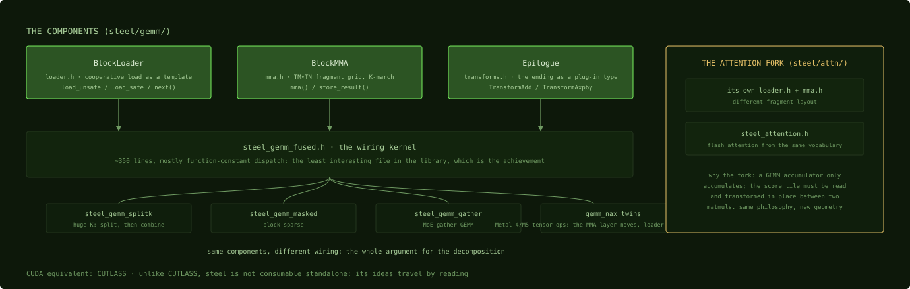

# Steel: the GEMM as components

## Where we are

Chapter 17 ended with the dispatcher choosing `steel_gemm_fused` and its tile
sizes for the running example on the plain path, the one every chip before M5
takes and an M5 takes for 32-bit with TF32 off. Steel is MLX's kernel library, and it does for Apple
Silicon what CUTLASS does for CUDA: it decomposes matrix multiply and attention
into composable C++ templates that one wiring kernel assembles per shape. This
chapter reads the three components and the kernel that wires them. You have
already seen all three in hand-written form in Part 4, so the task here is to
recognize them. Steel is the same cooperative load, the same register-blocked multiply
and the same fused epilogue, recomputed from template parameters for each tile
shape MLX precompiles, six per type, with the problem dimensions as run-time
arguments.

## The library in one picture

Steel lives in `mlx/backend/metal/kernels/steel/`. If you have read CUTLASS's
`Gemm` hierarchy, steel reads like a shorter version of it, adapted to
`simdgroup_matrix` fragments and 32 KB of threadgroup memory.



*Steel has three components and many wirings. Every sibling kernel at the bottom
reuses the same green boxes; the attention fork on the right is the one place
where the geometry itself had to change.*

- `BlockLoader`, in `gemm/loader.h`: the cooperative load of Chapter 11 as a
  template, with an unchecked vectorized variant and a bounds-checked,
  zero-filling variant that function constants select between.
- `BlockMMA`, in `gemm/mma.h`: the register-blocked multiply of Chapter 12, a
  grid of 8 by 8 fragments per simdgroup marched along the shared dimension.
- Epilogues, in `gemm/transforms.h`: the ending as a plug-in type, Chapter 15.
- The wiring kernels, in `gemm/kernels/`: `steel_gemm_fused.h`, and siblings that
  reuse the same components for other shapes, `steel_gemm_splitk.h` for huge
  shared dimensions, `steel_gemm_masked.h` for block-sparse, `steel_gemm_gather.h`
  for mixture-of-experts gathers, `steel_gemm_segmented.h`.
- The attention fork, in `attn/`: flash attention needs its middle matrix
  transformed in place between two multiplies, so `attn/` carries its own
  `mma.h` and `loader.h` with a different fragment layout, Chapter 21.
- The NAX fork: a parallel steel that targets the M5 neural accelerators through
  Metal 4 tensor operations, Chapter 29. Diffing a `_nax` kernel against its
  plain sibling shows what the new hardware changes: the multiply layer first,
  and with it the loading, the staging and the epilogue.

## BlockLoader: the cooperative load, derived

Most of the design is in the template head. Its defaulted parameters do the
arithmetic that Chapter 11 did by hand.

```cpp
template <
    typename T,
    short BROWS,
    short BCOLS,
    short dst_ld,
    short reduction_dim,
    short tgp_size,
    short alignment = 1,
    short n_reads = (BCOLS * BROWS) / (tgp_size),
    short TCOLS = BCOLS / n_reads,
    short TROWS = tgp_size / TCOLS>
struct BlockLoader {
```
Source: [`steel/gemm/loader.h:14-25`](https://github.com/ml-explore/mlx/blob/47bbfe8fa473d6d19037a8d97f1f7d30514e4cf6/mlx/backend/metal/kernels/steel/gemm/loader.h#L14-L25)

`n_reads` is the tile's element count divided by the threadgroup size, each
thread's share; `TCOLS` and `TROWS` derive the thread-to-tile mapping from it.
For the 64 by 16 tile and 128 threads of Part 4 that is 8 elements per thread,
2 threads per row of the tile, 64 rows covered 64 at a time. The same template
works for any compatible tile shape and threadgroup size (the divisions must
come out whole), with the layout constants fixed at compile time; the
constructor still computes each thread's source and destination offsets from
the run-time leading dimension.

The hot path expresses the vector width as an aligned type rather than a
`float4` cast, so that the compiler can emit one wide load per thread; the
payload width is `n_reads` elements, and what the compiler actually emits is a
question for its output (Chapter 26).

```cpp
  struct alignas(alignment * sizeof(T)) ReadVector {
    uint8_t v[sizeof(T) * vec_size];
  };
```
Source: [`steel/gemm/loader.h:42-44`](https://github.com/ml-explore/mlx/blob/47bbfe8fa473d6d19037a8d97f1f7d30514e4cf6/mlx/backend/metal/kernels/steel/gemm/loader.h#L42-L44)

```cpp
  METAL_FUNC void load_unsafe() const thread {
    STEEL_PRAGMA_UNROLL
    for (short i = 0; i < BROWS; i += TROWS) {
      *((threadgroup ReadVector*)(&dst[i * dst_ld])) =
          *((const device ReadVector*)(&src[i * src_ld]));
    }
  }
```
Source: [`steel/gemm/loader.h:73-80`](https://github.com/ml-explore/mlx/blob/47bbfe8fa473d6d19037a8d97f1f7d30514e4cf6/mlx/backend/metal/kernels/steel/gemm/loader.h#L73-L80)

What production adds that the hand-written kernel never needed is
`load_safe(short2 src_tile_dim)`, lines 83 to 128 of the same file, which bounds
checks and zero-fills for tiles that hang off the edge of the matrix. The
m5-gemm kernel required sizes divisible by 64; MLX cannot make that assumption.
What matters is when each variant runs: the function constants of Chapter 8 let the wiring kernel
compile pipelines where aligned dispatches contain only `load_unsafe`, so edge
handling costs nothing when no tile is off the edge.

The smallest method in the loader is the one that makes the components
composable.

```cpp
  METAL_FUNC void next() thread {
    src += tile_stride;
  }
```
Source: [`steel/gemm/loader.h:130-133`](https://github.com/ml-explore/mlx/blob/47bbfe8fa473d6d19037a8d97f1f7d30514e4cf6/mlx/backend/metal/kernels/steel/gemm/loader.h#L130-L133)

The loader owns its pointer arithmetic; the regular loop uses only the
constructor, a load and `next()`. That small surface is what lets quantized
loaders, transposed loaders and the attention fork's differently shaped loaders
swap in with little change to the loop, though not none: the fused kernel sets
the loaders' `src` directly for the K remainder, and quantized loaders take
scales and biases in their constructors.

## BlockMMA: register blocking, named

The layout constants turn the hand-written kernel's structure into named
parameters.

```cpp
struct BlockMMA {
  // MMAFrag size
  STEEL_CONST short kFragSize = 8;
  ...
  // Warp tile size along M
  STEEL_CONST short TM = BM / (kFragSize * WM);
  // Warp tile size along N
  STEEL_CONST short TN = BN / (kFragSize * WN);
  ...
  // Simdgroup matrices
  MMATile<AccumType, TM, 1, MMAFrag_acc_t> Atile;
  MMATile<AccumType, 1, TN, MMAFrag_acc_t> Btile;
  MMATile<AccumType, TM, TN, MMAFrag_acc_t> Ctile;
```
Source: [`steel/gemm/mma.h:453-483`](https://github.com/ml-explore/mlx/blob/47bbfe8fa473d6d19037a8d97f1f7d30514e4cf6/mlx/backend/metal/kernels/steel/gemm/mma.h#L453-L483), abridged

`WM` by `WN` is the simdgroup arrangement, the hand-written kernel's `SW` by
`SW`; `TM` by `TN` is each simdgroup's accumulator grid, its `SIMD_TILE` by
`SIMD_TILE`. `Ctile` lives in registers for the kernel's lifetime, with
`AccumType` defaulting to `float` regardless of the data type. That is the rule of Chapter 4:
16-bit traffic and 32-bit accumulation. The multiply marches the shared
dimension in fragment-size steps: load a column of `TM` A fragments and a row
of `TN` B fragments, 4 and 4 here, update the `TM` × `TN` = 16 accumulators,
advance. The simdgroup's fragments sit on a lattice, `TM_stride` = 8 × `WM`
rows and 8 × `WN` columns apart, which is the interleaved ownership Chapter 17
named.

```cpp
  METAL_FUNC void mma(const threadgroup T* As, const threadgroup T* Bs) thread {
    As += As_offset;
    Bs += Bs_offset;
    STEEL_PRAGMA_UNROLL
    for (short kk = 0; kk < BK; kk += kFragSize) {
      simdgroup_barrier(mem_flags::mem_none);
      Atile.template load<T, WM, 1, A_str_m, A_str_k>(As);
      simdgroup_barrier(mem_flags::mem_none);
      Btile.template load<T, 1, WN, B_str_k, B_str_n>(Bs);
      simdgroup_barrier(mem_flags::mem_none);
      tile_matmad(Ctile, Atile, Btile, Ctile);
      As += tile_stride_a;
      Bs += tile_stride_b;
    }
  }
```
Source: [`steel/gemm/mma.h:513-537`](https://github.com/ml-explore/mlx/blob/47bbfe8fa473d6d19037a8d97f1f7d30514e4cf6/mlx/backend/metal/kernels/steel/gemm/mma.h#L513-L537), abridged

Two details belong to production code. Transposition is handled by the stride constants: the
`A_str_m` and `A_str_k` pair swaps for a transposed operand, and the code never
branches on it. And the `mem_none` simdgroup barriers order no memory; they remain simdgroup
execution barriers, placed, the authors intend, to keep each simdgroup's
fragment loads batched (Chapter 7). The ending is where the epilogue plugs in: `store_result`,
lines 540 to 551, applies the `Epilogue` type to every accumulator element in
registers and then stores once, and the `apply_epilogue` variants additionally
read an input matrix for endings of the alpha × A × B + beta × C form. The
stock fused kernel exposes addition and axpby; an activation would be a new
transform type in the same slot. Because of this structure, an ending adds no
extra pass over the output, though its own operands are still read.

One caveat before you generalize from this file: attention needs a different
`mma.h`. Attention's score tile must be reduced along rows and transformed in
place between two multiplies, which the matrix-multiply component's tiles do
not provide, so `attn/` carries its own `mma.h`; the basic 8 by 8 lane
formulas are the same. Chapter 21 reads the other one.

## The wiring kernel: what is left

`steel_gemm_fused.h` is what remains of a matrix multiply once the loader, the
multiply and the epilogue are factored out: about 350 lines of wiring, most of
which is function-constant dispatch. Its head declares both specialization
mechanisms at once, template parameters for shape and function constants for
behavior, and Chapter 8 quoted the constants. The aligned fast path is the
hand-written loop of Chapter 12 rewritten against component interfaces.

```cpp
  if (align_M && align_N) {
    for (int k = 0; k < gemm_k_iterations; k++) {
      threadgroup_barrier(mem_flags::mem_threadgroup);
      loader_a.load_unsafe();
      loader_b.load_unsafe();
      threadgroup_barrier(mem_flags::mem_threadgroup);
      mma_op.mma(As, Bs);
      loader_a.next();
      loader_b.next();
    }
    ...
    return mma_op.store_result(D, params->ldd);
```
Source: [`steel_gemm_fused.h:172-204`](https://github.com/ml-explore/mlx/blob/47bbfe8fa473d6d19037a8d97f1f7d30514e4cf6/mlx/backend/metal/kernels/steel/gemm/kernels/steel_gemm_fused.h#L172-L204), abridged

The loop covers the same two hazards as Part 4 with the overwrite barrier
moved: barrier, load, barrier, multiply, advance, where the leading barrier
keeps this iteration's loads from overwriting a tile another simdgroup is still
reading, and the one after the loads makes the new tiles visible. A K remainder
is handled before this loop, so the aligned pipeline holds only `load_unsafe`
when `align_K` is true as well. The unaligned branches below it, lines 209 to
345, enumerate every ragged M and N combination through `load_safe` and
`store_result_safe`. That code is verbose and mechanical, and aligned pipelines
do not contain it. The kernel is the least interesting file in the library,
which shows that the decomposition worked.

Once this file reads as routine, the rest of steel's shape space is mostly a
list of names: each kernel reuses the same loader and multiply with different
wiring. That reuse is the argument for the decomposition. Two more facts set
steel's place among the alternatives. First, it is the baseline to beat, and it
usually wins: several independent projects report hand-written replacement
kernels coming back at 0.5 to 0.8 times stock steel (Chapter 25), so the
profitable moves are unlocking its fast paths rather than replacing it. Second,
unlike CUTLASS, steel has no packaged form outside MLX, so its ideas travel by
reading, which is what this chapter was for.

## Where the matmul stands

On the plain steel path, which for the 32-bit example is every chip before M5
or an M5 with TF32 disabled, the example runs as `steel_gemm_fused` with the
tile shape Chapter 17 chose: a `BlockLoader` object per operand and a `BlockMMA`
in every thread, whose distributed state forms each simdgroup's tile, and the
aligned pipeline, since 4096 is a multiple of every tile dimension. Its three parts map one to
one onto Chapters 11, 12 and 13.

## Check yourself

1. For a 64 by 16 tile of 32-bit floats and a threadgroup of 128 threads, what
   are `n_reads`, `TCOLS` and `TROWS`, and what do they mean?
2. The m5-gemm kernel has no `load_safe`. Why does steel need one, and why does an
   aligned dispatch not pay for it?
3. The `mma` loop contains three `simdgroup_barrier` calls with `mem_none`. What
   do they guard?

### Answers

1. `n_reads` = 64 × 16 / 128 = 8 elements per thread; `TCOLS` = 16 / 8 = 2 threads
   per tile row; `TROWS` = 128 / 2 = 64 rows covered per pass, so one pass covers
   the whole tile.
2. Because MLX must serve matrices whose sizes do not divide by the tile, so edge
   tiles need bounds checks and zero fill. An aligned dispatch binds all three
   alignment function constants true, and its pipeline contains only
   `load_unsafe`.
3. No memory: with `mem_none` they order no memory, though they remain
   execution barriers for the simdgroup. The authors place them to keep each
   simdgroup's fragment loads batched for the scheduler, which the source
   shows as intent, not as a measured effect.

The matrix multiply is in production, and the next chapter covers the one
framework feature that fuses the operations around it automatically.

Next: [mx.compile: fusing the long tail](19-mx-compile.md)
