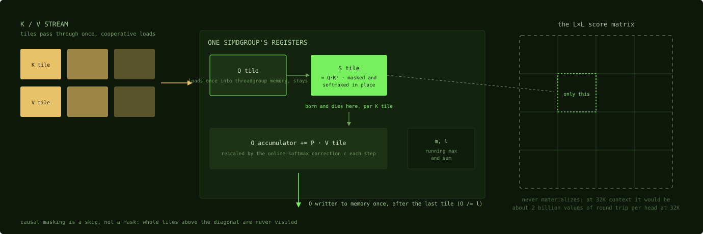

# Online softmax and flash attention

## Where we are

Part 5 put the matrix multiply into production. The other kernel that dominates a
language model is attention, and on this platform it is where the law of Chapter
3 matters most. Naive attention computes a matrix of scores between every query
and every key, writes it to memory, normalizes it, and reads it back. At a
context of 32,768 tokens that intermediate is 32,768 squared, about a billion
values, per head per layer. On a machine with laptop-class bandwidth, that
traffic rules naive attention out entirely. Flash attention never writes that matrix, and the
algorithm that makes that legal is five lines long. This chapter derives the five
lines, then shows the kernel shape they produce. The running example changes
here from a matrix multiply to attention.

## The problem: softmax needs two facts about the whole row

Safe softmax of a row of scores x is `exp(x_i - m) / sum_j exp(x_j - m)`, where
`m` is the row maximum, subtracted so that the exponents cannot overflow. Both
`m` and the sum are facts about the whole row, and a kernel that streams the row
one tile at a time does not have them when it starts. The kernel cannot
normalize a row it has not finished reading, and that is the whole obstacle.

## The resolution: one identity

For any old maximum `m_old` and new maximum `m_new`:

    exp(x - m_old) = exp(x - m_new) * exp(m_new - m_old)

So when a later tile raises the maximum, every term already accumulated against
the old maximum is off by exactly one factor, `c = exp(m_old - m_new)`, which is
at most 1. Multiply the running quantities by `c` and they are as if they had
been computed against the new maximum all along. Per tile of scores `S`, with a
running maximum `m`, a running sum `l` and a running output `O`:

    m_new = max(m, rowmax(S))
    c     = exp(m - m_new)         # correction, at most 1
    P     = exp(S - m_new)         # this tile's weights
    l     = l * c + rowsum(P)      # rescale the history, add the new tile
    O     = O * c + P * V_tile     # same correction, same reason
    m     = m_new

After the last tile, divide `O` by `l`. That is the algorithm, in five lines. If
you can re-derive the correction factor, you understand it: the sum and the
output were both accumulated as sums of `exp(x - m_old)` terms, so both need the
same factor when the reference maximum moves. Nothing about the row's length
enters the state; the kernel keeps one maximum, one sum and one output row per
query, whatever the context length.

Two platform notes from Part 1 attach to these lines. The exponent is computed
in base 2, with `log2(e)` folded into the scale once, so that the hot loop calls
`fast::exp2`, Chapter 5; the running maximum and the correction live in the same
scaled units. And the row reductions inside `rowmax` and `rowsum` are simdgroup
shuffles, Chapter 1, not trips through memory.

## The same five lines in two production dialects

You will meet this derivation in code in the next chapter, and seeing both
dialects now lets you recognize them there. MLX's attention kernel:

```cpp
    // Factor exp(rowmax(Si) - rowmax(Si-1))
    factor[i] = fast::exp2(max_score[i] - new_max[i]);
    ...
    sum_score[i] = sum_score[i] * factor[i] + sum_score_tmp[i];
    // Update O
    Otile.template row_bin_op<MulOp>(factor);
```
Source: [MLX `steel_attention.h:397-420`](https://github.com/ml-explore/mlx/blob/47bbfe8fa473d6d19037a8d97f1f7d30514e4cf6/mlx/backend/metal/kernels/steel/attn/kernels/steel_attention.h#L397-L420), abridged

`factor` is `c`; the sum update and the output rescale are lines four and five.
metal-flash-attention's generated kernel writes the same step this way:

```swift
    float correction = 1;
    if (m_new > m) {
      correction = fast::exp2(m - m_new);
      m = m_new;
    }
```
Source: [metal-flash-attention `AttentionKernel+Softmax.swift:293-298`](https://github.com/philipturner/metal-flash-attention/blob/8671cddc38f19a6eadb804dee6a3ca2954b8bf32/Sources/FlashAttention/Attention/AttentionKernel/AttentionKernel+Softmax.swift#L293-L298)

Note the `if` guard that MLX does not have: metal-flash-attention skips the
correction when the maximum did not move, while MLX multiplies by 1. The two
kernels disagree about whether a branch costs more than a multiply, and Chapter
21 returns to it.

The decode kernels of Chapter 22 reuse the same identity a second time, to merge
partial softmaxes computed by different simdgroups over different parts of the
key-value cache: each partial carries its own maximum and sum, and the merge
rescales both to a common maximum. That is how they avoid the float atomics of
Chapter 5.

## Flash attention: the kernel shape

With online softmax in hand, flash attention computes `softmax(Q * K^T / sqrt(d))
* V` without ever materializing the score matrix: stream K and V in tiles, hold
each tile's scores in registers, fold its contribution into the running output.
The algorithm is the same as on NVIDIA. What differs here is how much it
matters: on any GPU the intermediate is expensive, and on a bandwidth-bound machine with
laptop memory it is the difference between a workable context length and none.

The anatomy is common to every implementation, and Chapter 21 reads MLX's line
by line.

1. The Q tile loads once and stays, the resident tile that Chapter 2 named as the
   exception to the pass-through rule. K and V stream past by cooperative loads.
2. `S = Q * K^T` lands in a register tile. The score matrix exists only as one
   simdgroup's `simdgroup_matrix` fragments; it is masked and softmaxed in place,
   multiplies V, and dies. This transform-in-place requirement is why steel
   forked its attention multiply from the matrix-multiply one, Chapter 18.
3. Online softmax makes the streaming legal; the base-2 exponent path makes it
   cheap.
4. Where possible, causal masking skips tiles instead of masking them: whole
   tiles above the diagonal are never visited. This is the first of the three
   questions of Chapter 24, delete work.
5. Specialization strips the masking and alignment code the shape does not need:
   function constants in MLX, head-dimension enumeration in llama.cpp, code
   generation in metal-flash-attention, Chapter 21.



*Everything green lives in one simdgroup's registers, everything amber streams
through once, and the dashed matrix on the right is the one the algorithm avoids
writing.*

Count the traffic that step 2 saves, for one head at a context of L tokens and a
head dimension of d. Naive attention writes the L by L score matrix and reads it
back: 2 L² values. Flash attention reads K and V once, 2 L d values, plus Q and
the output. At L = 32,768 and d = 128, that is about 2.1 billion values against
about 8.4 million, a factor of L / d = 256 less traffic. In 16-bit at the
measured 516 GB/s of Chapter 3, the naive intermediate alone would cost about 8
milliseconds per head per layer. Multiplied across every head and layer, that
cost is the reason the technique exists.

## Two boundaries on this platform

**Decode is a different problem.** One query row cannot fill an 8 by 8 tile, so
every implementation ships a separate vector kernel for generation, Chapter 22.

**The backward pass is unfinished business.** MLX's fused attention has no Metal
backward; the entire GPU implementation, verbatim:

```cpp
bool ScaledDotProductAttentionVJP::use_fallback(const array& q, Stream s) {
  return true;
}

void ScaledDotProductAttentionVJP::eval_gpu(
    const std::vector<array>& inputs,
    std::vector<array>& outputs) {
  throw std::runtime_error("NYI");
```
Source: [MLX `scaled_dot_product_attention.cpp:796-803`](https://github.com/ml-explore/mlx/blob/47bbfe8fa473d6d19037a8d97f1f7d30514e4cf6/mlx/backend/metal/scaled_dot_product_attention.cpp#L796-L803)

Training falls back to the unfused graph. The one open-source backward on the
platform, metal-flash-attention's split dQ and dK, dV design, forced by the
emulated float atomics of Chapter 5, ships in the Draw Things application rather
than in a framework. If you are looking for the ecosystem's most valuable
unwritten kernel, it is this one.

## Where the matmul stands

The example is now attention: one head at a long context, with the score matrix
held in registers one tile at a time and never written. What is left to decide
is how the three production kernels on the platform make the engineering choices
the algorithm leaves open.

## Check yourself

1. A kernel has accumulated `l` = 10 and `O` = 4 against a running maximum of 3,
   and the next tile's maximum is 5. What are `c`, and the rescaled `l` and `O`,
   before the new tile is added?
2. Why do the sum and the output need the same correction factor?
3. At L = 8,192 and d = 128, how many times less traffic does flash attention
   move than naive attention, by the chapter's count?

### Answers

1. `c` = exp(3 - 5) = exp(-2), about 0.135; `l` becomes about 1.35 and `O` about
   0.54, after which the new tile's weights, computed against 5, are added.
2. Because both were accumulated as sums of `exp(x - m_old)` terms, the sum of
   the weights and the sum of the weights times V, so when the reference maximum
   moves, every term in both sums is off by the same factor.
3. L / d = 8,192 / 128 = 64 times: 2 L² = 134 million values against 2 L d = 2.1
   million.

The algorithm is settled; the next chapter reads three production kernels that
implement it and disagree about everything else.

Next: [Three attention kernels, one algorithm](21-three-attention-kernels.md)
