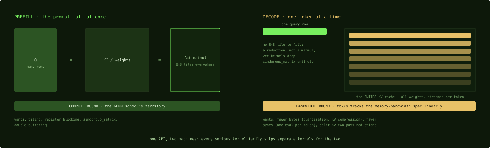

# The KV cache, decode, and prefill

## Where we are

Chapter 21 ended on the case every attention kernel in it refuses: one query row.
That case is generation, and it is most of what a language model does when you
talk to it. This chapter separates the two workloads that share the name
"inference", explains why generation cannot use the matrix kernels, and names
the data structure whose size becomes generation's latency on this platform.

## Two workloads, one API

Language-model inference is two different workloads behind one API. Prefill
processes the prompt: every token's query against every token's key, which is
a big matrix multiply, and compute bound by the arithmetic of Chapter 3. Decode
generates one token at a time: one query row against the whole history, which is
a dot product per key, and bandwidth bound. Every serious kernel family on this
platform ships separate kernels for the two.

The split exists in CUDA too; serving systems such as vLLM specialize decode.
The split matters more on this platform. Decode streams the entire key-value
cache and all the model's weights for every token it generates, which is pure
bandwidth work, and on Apple Silicon bandwidth is the scarce resource. That is why generation speed in tokens
per second tracks the memory-bandwidth spec almost linearly across chip tiers,
and why the buying advice of Chapter 25 is to read the bandwidth line and ignore
the core count.

*The two shapes. Prefill has tiles to feed the matrix hardware; decode is one
green row against everything in amber, which is why its speed is a bandwidth
number.*

## The KV cache: the structure decode streams

The key-value cache stores every past token's key and value vectors so that
attention never recomputes them. It is the same structure everywhere; vLLM's
paged version made it famous. On bandwidth-bound hardware its size converts
directly into decode latency, because decode streams all of it on every token.
That makes it the most consequential data structure on this platform.

Per token, per layer, the cache holds one key vector and one
value vector per key-value head. For a typical dense model of 7 to 8 billion
parameters, about 32 layers with key-value heads times head dimension of about
1,024, in 16-bit, that is 2 × 1,024 × 2 bytes × 32 layers, about 128 KB per
token. A 32,768-token context therefore carries about 4 GB of cache, and every
generated token streams all of it through the attention kernel. At the measured
495 GB/s read bandwidth of Chapter 3, 4 GB is about 8 milliseconds per token for
the cache alone, before the weights.

Three consequences follow.

- **Long context turns decode into a cache-streaming benchmark.** The sparse-V
  win of Chapter 25, 22.8 percent faster decode at 32K context, comes from
  deleting cache traffic.
- **Grouped-query attention is a cache compression scheme** as much as an
  attention variant: fewer key-value heads mean a smaller cache and faster
  decode, which is why steel attention implements it as a stride trick, Chapter
  21.
- **Quantizing the cache is the next lever after quantizing the weights**, and it
  is asymmetric in a way weight quantization is not.

The asymmetry was measured by the turboquant-mlx project. Quantizing K to 4
bits or below breaks greedy decode: softmax is sensitive to small perturbations
of the scores, and K sits upstream of the softmax. V tolerates 3-bit quantization
well, because V is consumed by a weighted average, which absorbs noise. The
project's mixed configuration, 8-bit K and 4-bit V, cut a 6.21 GB 16-bit cache to
5.08 GB with greedy output verified identical to the baseline. As a general rule,
treat K's precision as accuracy-critical and V's as a bandwidth knob. Reports of
a uniform `kv_bits=4` corrupting long prefilled contexts come from ignoring this
asymmetry. A quantized cache also does not speed up prefill at all, because
prefill's cost is the matrix multiplies, not cache streaming.

Layout matters at the kernel level. The simple layout is one contiguous ring per
layer. Serving stacks use paged layouts, fixed-size blocks plus an indirection
table, so that many sequences share memory without fragmentation, and paged layouts
exist on Metal too: the official vLLM plugin ships a paged variable-length attention
kernel, and MTPLX carries a family of paged-attention Metal kernels. For
single-user decode, the contiguous cache plus the split kernels below is all
you need.

## Why decode cannot use the matrix kernels

With one query row there is no 8 by 8 tile to feed `simdgroup_matrix`, Chapter
12, and the matrix path would compute mostly on padding. A one-row attention is
a reduction, not a matrix multiply. So decode runs on a different kind of kernel.

- **MLX** runs `sdpa_vector.h`, dispatched by the gate of Chapter 21 when the
  query length is at most 8: wide vector loads, simdgroup reductions, no matrix
  operations. Its data flow is the one Chapter 2 called out as different: each
  thread loads keys straight into its own registers and accumulates, and
  threadgroup memory is used for the reduction across simdgroups, not for
  staging.
- **llama.cpp** runs `kernel_flash_attn_ext_vec`. Because one row of work cannot
  fill the GPU, it splits the key-value cache across simdgroups and across
  threadgroups, merges the simdgroups' partial results inside the first kernel
  through threadgroup memory, and merges the threadgroups' partials in a second
  kernel, using the online-softmax correction identity of Chapter 20 for the
  merge: the two-pass shape that the emulated float atomics of Chapter 5 force.
- **The quantized matrix-multiply family splits the same way**, Chapter 23: a
  matrix-vector kernel for decode, dequantizing in registers, against a tiled
  kernel for prefill. The MTPLX case of Chapter 24 falls in the gap between
  them, where speculative decoding's 3 to 6 query rows fit neither tuning.

## Practical readings of the split

**Different optimizations apply.** Prefill wants everything in the
matrix-multiply school of Part 4. Decode wants fewer bytes (quantized weights and
cache compression) and fewer synchronizations (one evaluation per token, Chapter
16).

**Benchmark them separately.** A "2 times faster attention" that speeds up
prefill only is invisible in a chat loop, and the classic failed-kernel
post-mortem of Chapter 25 is a synthetic prefill win with zero end-to-end effect.

**Batch size moves the boundary.** Speculative decoding, parallel sampling and
serving push decode toward small-M matrix multiply, a few query rows at a time.
That is the least-tuned regime in every kernel family, and historically it is
where the cheap wins have been.

## Where the matmul stands

The example has two numbers now. For prefill, the attention kernel of Chapter 21
and the matrix multiply of Part 4 are compute bound. For decode, one token at a
32K context streams about 4 GB of cache plus the weights, and the time is set by
bandwidth: at about 495 GB/s, the cache alone is about 8 milliseconds per token.
Everything that speeds decode from here deletes bytes.

## Check yourself

1. A model has 40 layers, 8 key-value heads of dimension 128, stored in 16-bit.
   How many bytes of cache per token, and how large is the cache at 16,384
   tokens?
2. Why does quantizing V to 4 bits work where quantizing K to 4 bits breaks
   greedy decode?
3. A kernel change makes prefill 2 times faster and leaves decode unchanged.
   What does a chat user see, and what should the benchmark have reported?

### Answers

1. 2 vectors × 8 heads × 128 × 2 bytes × 40 layers = 163,840 bytes, about 160
   KB per token; at 16,384 tokens that is about 2.5 GiB.
2. Because V is consumed by a weighted average, which absorbs small errors, while
   K feeds the scores that go through the softmax, which amplifies small
   perturbations into changed weights.
3. The time to the first token halves and the time per generated token does not
   change, so a long conversation looks the same. The benchmark should have
   reported prefill and decode separately, and end to end.

Decode deletes bytes, and the largest deletion available is in the weights
themselves: the next chapter is about storing them in 4 bits and multiplying
against them without ever expanding them.

Next: [Quantization as a bandwidth optimization](23-quantization.md)
