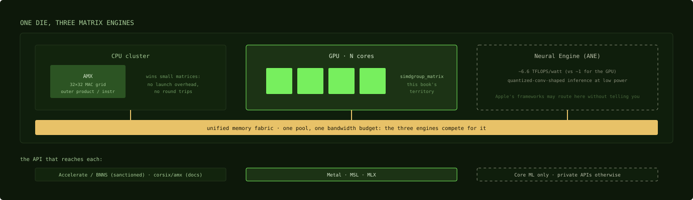

# Three matrix engines on one die

## Where we are

Every kernel this book read in Parts 4 to 6 uses `simdgroup_matrix`, which runs
on the GPU's regular arithmetic pipes, and until the M5 generation that is all
the GPU had: Chapter 12 said `simdgroup_matrix` is the API of a Tensor Core on
hardware that had none. The benchmarks ran on an M5 Max, and Chapter 17 showed
MLX's own dispatcher already taking the other route there; what you read was the
portable path. The last part of this book
is about the hardware that changed that, and the programming model that reaches
it. This chapter starts one level up, with the three matrix engines that share
one Apple die, because two of them affect GPU work whether or not you ever
program them, and the third is the new one.

## The die has three matrix engines



*Where the engines sit. Three share one bandwidth budget; Metal talks to the
middle one, and the API rows at the bottom are the only ways to reach each.*

**AMX, on the CPU.** AMX is Apple's undocumented CPU matrix coprocessor. It is
not part of the GPU, but it is the other half of Apple's matrix-multiply
performance, and it explains small-matrix CPU throughput that NEON alone could
not deliver. There is
no CUDA counterpart; the closest analogies are Intel's AMX and ARM's SME, toward
which Apple's AMX has been evolving. The point for a GPU engineer is negative:
when you benchmark Apple's Accelerate, BNNS or MPS small-matrix performance and
the numbers look too good for a CPU, you are not looking at the CPU's NEON units.
You are looking at a dedicated multiply-accumulate grid hanging off the CPU
cluster, fed by its own register pools, executing an outer product per
instruction. Apple has never documented the instruction set. The definitive
reference is corsix/amx (MIT licensed), which has per-instruction documentation, an executable
emulator that serves as the specification, and per-generation deltas: M2 adds bf16, M3 adds
new load and integer modes, M4-era hardware moves toward standard SME. Using AMX
directly means issuing undocumented instructions. Accelerate and BNNS are the
sanctioned interface, and corsix's documentation is where you find out what
those libraries can be doing underneath the numbers you measure.

AMX matters to GPU work in two ways. The first is dispatch: for small matrices, the
fastest processor on the chip is often AMX, not the GPU, because kernel launch
overhead plus the round trips of Chapter 7 swamp the GPU's advantage below a size
threshold, and Accelerate and BNNS, which run on the CPU side, can use it.
Metal Performance Shaders cannot: MPS encodes its matrix multiply into a command
buffer and runs it on the GPU, which is how Chapter 9 timed it with GPU
timestamps. So if Accelerate beats your kernel at 256 by 256, this is frequently
why; if MPS does, the explanation is in the GPU kernel and its dispatch, not in
AMX. The second is the shared memory pool: unified memory means CPU-side AMX
work and GPU work compete for the same bandwidth, so a background BNNS workload
can cut the bandwidth a bandwidth-bound GPU kernel achieves.

**The Neural Engine.** The third engine is also undocumented, and you can reach it
only through Apple's model frameworks or private interfaces. It delivers about 6.6
TFLOPS per watt against about 1 for the GPU (Chapter 25). Metal does not talk to it.

**The GPU's own matrix unit, from M5.** The M5 generation adds a dedicated matrix
unit to every GPU core: the neural accelerators, NAX in MLX's source, reached
through Metal 4 tensor operations rather than through `simdgroup_matrix`. This is
the first real Tensor Core counterpart on the GPU.

## What M5 changes, and what it does not

The earlier chapters told the pre-M5 story on purpose. `simdgroup_matrix`
executes on the regular 32-bit pipes, and the reverse-engineered Rigel work
confirmed no dedicated matrix datapath as late as M4. On M5 that changed, and
Apple's own numbers for MLX on M5 say where: about 3.97 times faster time to
first token and 1.19 to 1.27 times faster decode than M4, end-to-end numbers
that fold in everything else that changed between the chips. The prefill gain
is where a matrix unit should show, in the compute-bound territory of
Chapter 3. Decode stays bandwidth bound, so it moves with the memory spec
instead (Chapter 22). The two numbers follow the compute-bound versus
bandwidth-bound split that the rest of the book uses.

What you should carry over from CUDA, and what not to:

- **The fragment shape moves from 8 by 8 to 16 by 16.** MLX's NAX steel is built
  on a 16 by 16 fragment held across the 32 threads of a simdgroup.

```cpp
struct BaseNAXFrag {
  STEEL_CONST short kFragRows = 16;
  STEEL_CONST short kFragCols = 16;

  STEEL_CONST short kElemsPerFrag = (kFragRows * kFragCols) / 32;
```
Source: [MLX `steel/gemm/nax.h:27-31`](https://github.com/ml-explore/mlx/blob/47bbfe8fa473d6d19037a8d97f1f7d30514e4cf6/mlx/backend/metal/kernels/steel/gemm/nax.h#L27-L31)

  The file includes `<MetalPerformancePrimitives/MetalPerformancePrimitives.h>`
  at the top: the new hardware arrives through a library, not through new
  intrinsics. Each thread holds 16 × 16 / 32 = 8 elements of a fragment, against
  2 for an 8 by 8 fragment. The fragment is MLX's storage unit; the operation it
  hands to the library is wider. The same file builds a
  `matmul2d_descriptor(16, 32, 16, ...)`, one A fragment against two B fragments
  side by side, and the tile loops Chapter 29 reads combine those operations.
- **The formats are block-scaled floats.** The `mxfp4`, `nvfp4` and `mxfp8`
  modes of Chapter 23 arrived with this unit and have NAX kernels, but in the
  pinned MLX those kernels dequantize the codes to 16-bit values before loading
  tiles, Chapter 23, so that code does not show the hardware taking the packed
  formats directly. The "fp8 is emulated" caveat of Chapter 4 is an M4-era
  fact.
- **It is not programmed like a Tensor Core.** There is no `mma.sync` to descend
  to. You describe a matrix multiply with a descriptor and cooperative tensors,
  and the compiler and the hardware choose the datapath. Chapter 29 covers the
  model and reads real code.

Software support is early. MLX ships a parallel steel fork for it (`gemm/nax.h`,
`attn/nax.h`, `quantized_nax` and `fp_quantized_nax`), llama.cpp has a tensor-API
matrix-multiply path, and the tuning is young. Recent MLX work is
disproportionately NAX-shaped: batch limits raised for M5-class GPUs,
NVFP4 matrix-vector optimization, and per-expert tile picks. The path is still
changing quickly. `simdgroup_matrix` remains the portable primitive. It runs on
every M-series chip and most shipped kernels still use it, which is why this
book teaches both.

## Where the matmul stands

On a 40-core M5 Max, the running example has a second route: the tiled matrix
multiply of Part 4 still runs on the regular pipes at the 13.5 TFLOPS Chapter 10
measured in 32-bit, and the same multiply described to the neural accelerators
runs on a dedicated unit with 16 by 16 fragments. For 32-bit inputs that route
multiplies in TF32, which changes the numerics, Chapter 17, so a comparison
between the two has to state the precision and check the error. The next
chapter reads the code for the second route.

## Check yourself

1. Accelerate beats your hand-written GPU matrix multiply at 256 by 256 but
   loses at 4096 by 4096. What does the chapter say is probably happening, and
   would the same explanation hold if it were MPS winning?
2. Apple reports M5 prefill about 4 times faster than M4 and decode about 1.2
   times faster. Why the difference?
3. How many elements of a 16 by 16 fragment does each thread of a simdgroup
   hold, and how does that compare with the 8 by 8 fragment of Chapter 12?

### Answers

1. At 256 by 256, kernel launch overhead and the round trips of Chapter 7 swamp
   the GPU's advantage, and the fastest processor for that size is often AMX on
   the CPU, which Accelerate can use; at large sizes the GPU's throughput wins,
   and the chapter gives no measured crossover, so find yours by measuring. If
   MPS were winning, no: MPS runs on the GPU, so the explanation would be in the
   two GPU kernels, not in AMX.
2. Prefill is compute bound, so a new matrix unit raises its ceiling; decode at
   batch one on a dense model is bandwidth bound, so it moves mostly with the
   memory bandwidth, which changed by a smaller factor. Batching,
   mixture-of-experts routing and encoding overhead can shift that balance,
   Chapters 7 and 22.
3. 16 × 16 / 32 = 8 elements per thread, against 8 × 8 / 32 = 2 for the smaller
   fragment, and 8 / 2 = 4 times the elements per fragment at the same element
   type. That is payload per fragment, not more registers per output tile: four
   8 by 8 fragments cover the same 16 by 16 patch with the same element count.

The last chapter reads the programming model for the new unit and a kernel
written for it, and ends where the book began, with a matrix multiply.

Next: [Tensor ops and the NAX GEMM](29-tensor-ops-and-the-nax-gemm.md)
